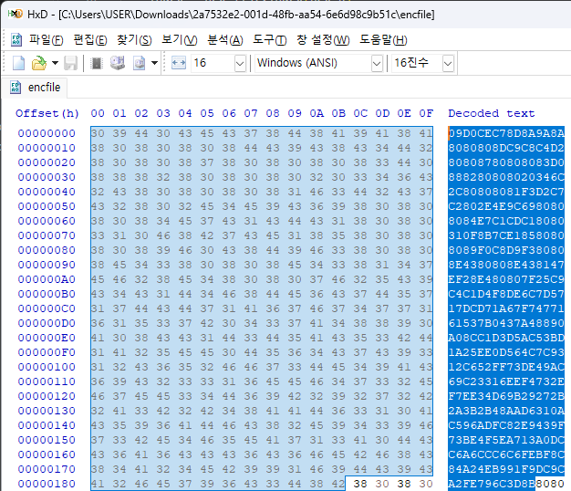
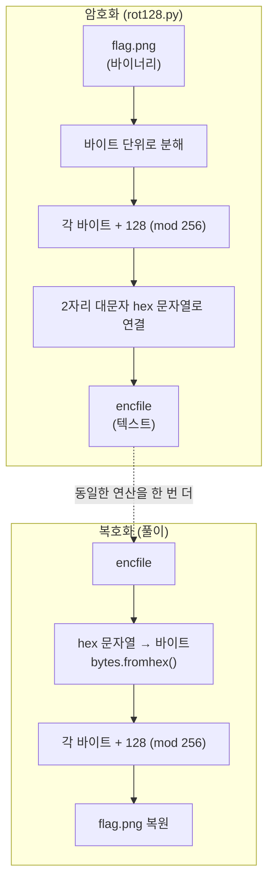
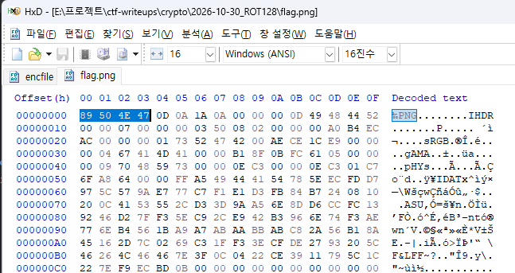

# [Crypto] ROT128

| 항목 | 내용 |
| --- | --- |
| 플랫폼 | Dreamhack 워게임 |
| 문제 URL | https://dreamhack.io/wargame/challenges/852 |
| 분야 | Crypto |
| 난이도 | B4 |
| 풀이 날짜 | 2026-10-30 |
| 소요 시간 | 10min |
| 핵심 키워드 | ROT128, 시저 암호(고정 shift), 바이트 단위 치환, 자기 역원(involution), 파일 시그니처 |
| CWE | CWE-327 (Use of a Broken or Risky Cryptographic Algorithm) · CWE-326 (Inadequate Encryption Strength) |

## 1. 문제 개요
암호화 스크립트(`rot128.py`)와 그 결과물(`encfile`)이 주어집니다. 스크립트는 `flag.png`를 읽어 암호화를 한 뒤, 그 결과를 `encfile`에 저장합니다. 암호화 과정을 거꾸로 수행해 원본 `flag.png`를 복원하고, 이미지에 적힌 플래그를 읽어내는 것이 목표입니다.

## 2. 정찰(Recon)
제공된 `rot128.py`에서 암호화 로직을 확인했습니다.

```python
plain_list = [hex(i)[2:].zfill(2).upper() for i in plain_s]      # 바이트 → 2자리 hex 문자열

enc_list = list(range(len(plain_list)))
for i in range(len(plain_list)):
    hex_b = plain_list[i]
    index = hex_list.index(hex_b)                                 # 바이트 값(0~255)
    enc_list[i] = hex_list[(index + 128) % len(hex_list)]         # +128, mod 256
```

- 테이블 인덱스가 곧 바이트 값이므로 `index + 128`은 **바이트 값에 128을 더하는 연산**과 같습니다.
- 키·IV·난수가 전혀 없고, 모든 바이트에 **같은 규칙**이 적용됩니다.
- `encfile`을 확인하면 `0-9A-F` 문자만 존재하는 것을 알 수 있습니다.

>

### 암호화 · 복호화 과정



mod를 활용한 암호화는 **암호화와 복호화가 같은 연산**이라는 점을 이용했습니다.

| 구분 | 연산 | 비고 |
| --- | --- | --- |
| 암호화 | `c = (p + 128) mod 256` | 스크립트 그대로 |
| 복호화 | `p = (c + 128) mod 256` | 128 + 128 = 256 ≡ 0 (mod 256) |

## 3. 취약점 분석
- **키가 없는 고정 치환 암호**: 시프트 값(128)이 알고리즘에 고정되어 있어, 알고리즘을 아는 순간 누구나 복호화할 수 있습니다. 비밀은 "키"가 아니라 "알고리즘의 비공개"뿐이므로 **케르크호프스의 원칙**을 위반합니다.
- **자기 역원(involution) 구조**: `f(f(x)) = x` 이므로 암호화 함수를 한 번 더 적용하면 곧바로 복호화가 됩니다. 별도의 복호화 로직을 만들 필요조차 없습니다.
- **알고리즘이 공개되지 않아도 깨짐**: 단일 바이트 치환이기 때문에, 알려진 평문(known-plaintext)만으로도 shift 값을 즉시 역산할 수 있습니다. PNG 파일의 시그니처는 `89 50 4E 47`이고, `encfile`의 앞부분이 `09 D0 CE C7`이므로 모든 바이트가 정확히 `+128` 차이임을 한눈에 확인할 수 있습니다.
- CWE-327(취약한/위험한 암호 알고리즘 사용), CWE-326(불충분한 암호 강도).

## 4. 시도와 실패
| 시도 | 결과 | 배운 점 |
| --- | --- | --- |
| bytes 함수 미사용(`encfile`을 텍스트 그대로) | 실패 (깨진 파일) | `encfile`은 바이너리가 아니라 **hex 텍스트**이기에 `bytes.fromhex()`사용 필수 |
| hex 문자열의 문자 하나하나(`'0'`, `'9'`, `'D'` …)에 +128을 적용 | 실패 (PNG로 인식되지 않음) | `rot128.py`의 연산 단위는 hex 문자가 아니라 **2자리 hex가 나타내는 바이트(0~255)**. "문자 단위 ROT"와 혼동하지 말고, 변환 단위(바이트)를 암호화 코드에서 먼저 확인해야 함 |

## 5. 익스플로잇
1. `encfile`(hex 텍스트)을 읽어 바이트로 변환합니다.
2. 각 바이트에 128을 더하고(mod 256) `flag.png`로 저장하는 복호화 스크립트를 작성합니다.
   ```python
   #!/usr/bin/env python3
   with open('encfile', 'r', encoding='utf-8') as f:
       enc = bytes.fromhex(f.read().strip())     # hex 텍스트 → 바이트

   plain = bytes((b + 128) % 256 for b in enc)   # 암호화와 동일한 연산

   with open('flag.png', 'wb') as f:
       f.write(plain)
   ```

3. 복원된 파일이 정상적인 PNG인지 확인합니다. (시그니처 `89 50 4E 47`, 끝부분 `IEND` 청크)



## 6. 방어 관점
- **근본 대책**: 직접 만든 암호 알고리즘을 쓰지 않고, 검증된 표준 알고리즘과 **비밀 키**를 사용합니다. 파일 암호화라면 인증 암호화(AEAD)를 쓰고, 보안은 알고리즘의 비공개가 아니라 키의 비밀성에 두어야 합니다.
  ```python
  # 기존(취약) — 키 없는 고정 shift, 알고리즘을 알면 누구나 복호화
  enc = (b + 128) % 256

  # 개선 — 표준 라이브러리의 AEAD 사용
  from cryptography.hazmat.primitives.ciphers.aead import AESGCM
  import os

  key = AESGCM.generate_key(bit_length=256)    # 키 관리 시스템/환경변수 등으로 분리 보관
  aesgcm = AESGCM(key)
  nonce = os.urandom(12)                        # 암호화마다 새로 생성 (재사용 금지)
  ciphertext = aesgcm.encrypt(nonce, plain_bytes, None)
  ```
- **보완 대책**:
  - 키는 코드·저장소에 두지 않고 KMS/Vault 등에서 관리하고, 주기적으로 교체합니다.
  - 암호문을 hex/base64로 인코딩하는 것은 "표현 방식"일 뿐 암호화가 아니므로, 인코딩과 암호화를 혼동하지 않도록 코드 리뷰에서 확인합니다.
  - 코드 리뷰·SAST 단계에서 "직접 구현한 암호 로직"(`% 256` 덧셈/XOR 고정값 등)을 경고 대상으로 둡니다.

## 7. 탐지 관점
이 유형은 네트워크 공격이 아니라 **취약한 암호 사용 자체**이므로, 런타임 로그보다는 코드·산출물 점검 단계에서의 탐지해야 합니다.
  ```yaml
  rules:
    - id: custom-fixed-shift-cipher
      languages: [python]
      severity: WARNING
      message: 키 없는 고정 상수 shift/XOR 연산으로 보이는 직접 구현 암호 (CWE-327)
      patterns:
        - pattern-either:
            - pattern: ($X + $C) % 256
            - pattern: $X ^ $C
  ```
- **산출물 점검**: 암호화되었다고 알려진 파일이 `0-9A-F`/base64 문자만으로 구성되어 있거나, 복호화 시도 없이도 알려진 파일 시그니처(`89 50 4E 47` 등)를 특정 상수 차이로 만족하면 취약한 암호 사용을 의심합니다.
- **오탐 가능성과 완화**: 해시 계산·체크섬·인덱스 순환(`% 256`)처럼 보안과 무관한 연산도 같은 패턴으로 잡힐 수 있으므로, 입력이 **민감 데이터(파일, 비밀번호, 토큰 등)** 인 경우로 범위를 좁히고, 사람이 코드 리뷰에서 최종 확인합니다.
