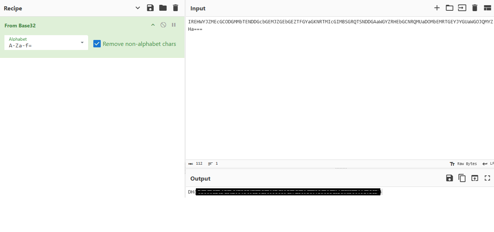

# [Crypto] likeb64

| 항목 | 내용 |
| --- | --- |
| 플랫폼 | Dreamhack 워게임 |
| 문제 URL | https://dreamhack.io/wargame/challenges/1020 |
| 분야 | Crypto |
| 난이도 | B4 |
| 풀이 날짜 | 2026-10-30 |
| 소요 시간 | 10min |
| 핵심 키워드 | Base32, 커스텀 알파벳 인코딩, 패딩(`=`) 분석 |
| CWE | CWE-327 (Use of a Broken or Risky Cryptographic Algorithm) · CWE-656 (Reliance on Security Through Obscurity) |

## 1. 문제 개요
"드림이가 base64를 공부하고 자신만의 암호를 만들었다"는 설명과 함께 암호문 1개(`target.txt`)가 주어집니다. 문제는 **hint로 알파벳 순서(`ABCDEFGHIJKLMNOPQRSTUVWXYZabcdef`)** 를 알려주며, 이 암호문을 복호화해 `DH{...}` 형식의 플래그를 얻는 것이 목표입니다.

## 2. 정찰(Recon)
암호문을 분석해 어떤 인코딩인지 먼저 좁혔습니다.

```
IREHWYJZMEcGCODGMMbTENDDGcbGEMJZGEbGEZTFGYaGKNRTMIcGIMBSGRQTSNDDGAaWGYZRHEbGCNRQMUaDOMbEMRTGEYJYGUaWGOJQMYZHa===
```

| 관찰 | 의미 |
| --- | --- |
| 마지막 패딩(`=`) 3자 | base64, base32 등 계열의 인코딩 |
| hint 알파벳이 정확히 **32자** (`A-Z` 26자 + `a-f` 6자) | Base32로 추축 |
| 마지막 블록: 109 mod 8 = 5글자 + `===` | Base32에서 5글자(25비트) → 3바이트 + 패딩 `===`와 정확히 일치 |

- 이름은 `likeb64`지만 알파벳 크기와 패딩 규칙은 **Base32**입니다. (Base64라면 길이 109가 4의 배수가 아니라 디코딩 자체가 불가능합니다.)

## 3. 취약점 분석
- **키가 없는 인코딩**: 알파벳 치환은 비밀 키가 아니라 **고정된 테이블**입니다. 테이블이 hint로 주어졌지만, hint가 없었더라도 알파벳이 32자·패딩이 `===`라는 점에서 Base32임을 추정하고, 숫자 자리에 해당하는 소문자만 맞춰 보면 짧은 시간에 복구할 수 있습니다.
- **인코딩 ≠ 암호화**: Base32/64는 데이터를 텍스트로 표현하는 방식일 뿐 기밀성을 제공하지 않습니다. 알파벳을 바꿔도 "모양을 바꾼 것"이지 비밀이 생기지는 않습니다.
- **구조가 그대로 노출됨**: 패딩 `=`의 개수와 전체 길이(8의 배수)가 인코딩 종류를 알려 주고, 알파벳 크기(32)가 Base32임을 확정해 줍니다. 모호성(Security through Obscurity)에 보안을 의존한 설계입니다.
- 공격 난이도는 매우 낮고, 영향은 인코딩된 데이터(여기서는 플래그) 전체의 노출입니다.
- CWE-327(취약한/위험한 암호 알고리즘 사용), CWE-656(비공개에 의존한 보안).

## 4. 시도와 실패
| 시도 | 결과 | 배운 점 |
| --- | --- | --- |
| Base64로 디코딩 | 실패 (`Error: Base64 padding character (=) not used in the correct place.`) | 알파벳 크기(32)와 패딩 규칙(전체 길이 8의 배수, `===`) 으로 인코딩 종류를 판별해야 함 |
| 표준 Base32로 그대로 디코딩 (`base64.b32decode(s)`) | 실패 (`Data is not a valid byteArray: [68,72,123,97,57,97,12...`) | 소문자 `a`·`b`·`c`는 암호문에는 존재하지만 base32에서 사용하는 표준 알파벳(`A-Z`, `2-7`)에 없으므로 에러 발생. |

## 5. 익스플로잇
1. 정찰 결과에 따라 암호문을 hint로 받은 A-Za-f=('='은 패딩)을 알파벳으로 넣어 디코딩하여 플레그 획득



**(추가 실습)**
*python을 이용하여 직접 디코딩*
1. 정찰 결과에 따라 암호문을 표준 알파벳으로 되돌린 뒤 `base64.b32decode()`로 디코딩합니다.

   ```python
   import base64

   CUSTOM = "ABCDEFGHIJKLMNOPQRSTUVWXYZabcdef"   # 문제의 hint (32자)
   STD    = "ABCDEFGHIJKLMNOPQRSTUVWXYZ234567"   # 표준 Base32 알파벳

   with open('target.txt', 'r', encoding='utf-8') as f:
       enc = f.read().strip()

   std = enc.translate(str.maketrans(CUSTOM, STD))   # 커스텀 알파벳 → 표준 알파벳
   print(base64.b32decode(std).decode())
   ```

## 6. 방어 관점
- **근본 대책**: 인코딩(Base32/64)이나 알파벳 치환을 암호화로 쓰지 않습니다. 기밀성이 필요하면 검증된 표준 알고리즘과 **비밀 키**를 사용하고, 보안은 알고리즘·형식의 비공개가 아니라 키의 비밀성에 둡니다.
  ```python
  # 기존(취약) — 알파벳만 바꾼 Base32, 테이블을 알면 누구나 복원
  enc = base64.b32encode(secret).decode().translate(table)

  # 개선 — 표준 라이브러리의 AEAD 사용 (키는 별도 보관)
  from cryptography.hazmat.primitives.ciphers.aead import AESGCM
  import os

  key = AESGCM.generate_key(bit_length=256)     # 키 관리 시스템/환경변수 등으로 분리 보관
  aesgcm = AESGCM(key)
  nonce = os.urandom(12)                         # 암호화마다 새로 생성 (재사용 금지)
  ciphertext = aesgcm.encrypt(nonce, secret, None)
  ```
- **보완 대책**:
  - 텍스트로 전달해야 한다면 **암호화한 뒤에** Base64/Base32로 인코딩합니다. (인코딩은 전송 형식, 암호화는 보호 수단으로 역할 분리)
  - 비밀번호처럼 복원이 필요 없는 값은 암호화가 아니라 해시(`argon2`, `bcrypt`)로 저장합니다.
  - 코드 리뷰에서 "직접 만든 인코딩/치환 로직"을 보안 기능으로 사용하는지 점검합니다.

## 7. 탐지 관점
이 유형은 네트워크 공격이 아니라 **취약한 암호 사용 자체**이므로, 런타임 로그보다는 코드·산출물 점검 단계에서 탐지하는 것이 적합합니다.
  ```yaml
  # Semgrep 스타일 초안
  rules:
    - id: encoding-with-custom-alphabet-as-crypto
      languages: [python]
      severity: WARNING
      message: Base32/64 인코딩 결과를 알파벳 치환으로 가공 — 인코딩은 암호화가 아님 (CWE-327, CWE-656)
      pattern-either:
        - pattern: base64.b32encode(...).decode().translate(...)
        - pattern: base64.b64encode(...).decode().translate(...)
  ```
- **오탐 가능성과 완화**: 토큰·UUID·해시 문자열도 비슷한 문자 집합을 쓰므로, 길이·패딩 규칙(8의 배수 + `=`)과 **디코딩 결과가 출력 가능한 ASCII/구조화된 데이터인지**를 함께 확인해 좁힙니다.
