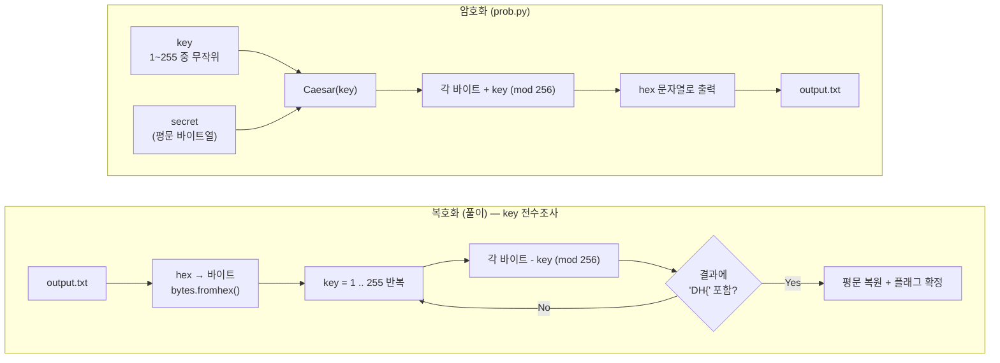
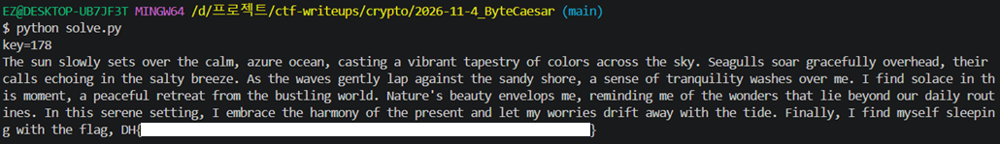

# [Crypto] ByteCaesar

| 항목 | 내용 |
| --- | --- |
| 플랫폼 | Dreamhack 워게임 |
| 문제 URL | https://dreamhack.io/wargame/challenges/1817 |
| 분야 | Crypto |
| 난이도 | B4 |
| 풀이 날짜 | 2026-11-4 |
| 소요 시간 | 15min |
| 핵심 키워드 | Caesar 암호, 바이트 단위 shift(mod 256), 자연어 통계 |
| CWE | CWE-327 (Use of a Broken or Risky Cryptographic Algorithm) · CWE-326 (Inadequate Encryption Strength) |

## 1. 문제 개요
암호화 스크립트(`prob.py`)와 그 실행 결과(`output.txt`)가 주어집니다. 스크립트는 `secret` 파일을 읽어 1~255 사이의 **무작위 1바이트 키**로 Caesar 암호화를 한 뒤, 결과를 hex 문자열로 출력합니다. 문제에 동봉된 `secret` 파일 자체는 `DH{FAKE_FLAG}`가 들어간 더미(로컬 테스트용 예시)이고, 실제로 복호화해야 할 대상은 `output.txt`에 출력된 암호문입니다.

## 2. 정찰(Recon)
제공된 `prob.py`에서 암호화 로직을 확인했습니다.

```python
class Caesar:
    def __init__(self, key):
        assert isinstance(key, int) and 1 <= key <= 255
        self._key = key

    def encrypt(self, msg):
        msg_enc = b""
        for b in msg:
            msg_enc = msg_enc + bytes([(b + self._key) % 256]) # (b+ key) mod 256
        return msg_enc

def main():
    key = random.randint(1, 255)        # 키는 1~255 중 무작위, 코드에 범위가 그대로 드러남
    ...
    secret_enc = cipher.encrypt(secret)
    print(f"my encrypted sentence > {secret_enc.hex()}")
```

- 암호화는 **한 바이트씩** `(b + key) mod 256`을 적용하는 구조입니다. 흔히 말하는 "문자 단위 시저 암호"(알파벳 26자 순환)가 아니라, 바이트 전체(0~255, 256가지)를 순환
- `key`의 범위는 `1 <= key <= 255`

### 암호화 · 복호화 과정



| 구분 | 연산 | 비고 |
| --- | --- | --- |
| 암호화 | `c = (p + key) mod 256` | 스크립트 그대로, `key`는 1~255 중 하나로 고정 |
| 복호화 | `p = (c - key) mod 256` | 암호화의 역연산. `key`를 모르므로 1~255를 전부 시도 |

## 3. 취약점 분석
- **키 공간이 지나치게 작음**: 키가 1바이트(1~255, 255가지)뿐이라 현대 컴퓨팅 자원으로 즉시 전수조사(brute force)할 수 있습니다.
- **치환 구조가 선형·단순**: 모든 바이트에 같은 `key`를 더하는 단일 바이트 shift이므로, 키 하나만 찾으면 전체 메시지가 한 번에 복원됩니다(복호화 과정이 암호화 과정의 역산).
- **평문이 자연어라 판별이 쉬움**: 이 문제에서는 플래그 형식(`DH{`)이 포함되는지를 기준으로 삼으면 복호화 과정 단순화 가능.
- CWE-327(취약한/위험한 암호 알고리즘 사용), CWE-326(불충분한 암호 강도).

## 4. 시도와 실패
| 시도 | 결과 | 배운 점 |
| --- | --- | --- |
| hex 문자열 전체(`my encrypted sentence > ` 포함)를 그대로 `bytes.fromhex()`에 입력 | 실패 | `output.txt`에는 안내 문구 2줄과 `my encrypted sentence > ` 접두어가 함께 들어 있습니다. `> ` 뒤의 hex 값만 추출한 뒤 변환해야 합니다 |

## 5. 익스플로잇
1. `output.txt`에서 `my encrypted sentence > ` 뒤의 hex 문자열만 추출해 바이트로 변환합니다.
2. `key`를 1부터 255까지 모두 대입해 복호화하고, 결과에 `DH{`가 포함되는 경우를 찾습니다.

   ```python
   #!/usr/bin/env python3
   with open('output.txt', 'r', encoding='utf-8') as f:
       enc_hex = f.read().strip().rsplit('> ', 1)[-1]   # 접두어 제거, hex만 추출

   enc = bytes.fromhex(enc_hex)

   for key in range(1, 256):                             # key 범위: 1~255 (소스 코드 기준)
       dec = bytes((b - key) % 256 for b in enc)          # 복호화: (c - key) mod 256
       if b'DH{' in dec:                                  # 플래그 형식으로 성공 여부 판정
           print(f'key={key}')
           print(dec.decode())
           break
   ```

3. 스크립트를 실행하면 `key=178`에서 완전한 영어 문장과 함께 플래그가 나옵니다.
   ```bash
   python3 solve.py
   ```




## 6. 방어 관점
- **근본 대책**: 직접 만든 암호(단일 바이트 shift)를 쓰지 않고, 검증된 표준 알고리즘과 충분히 큰 키 공간을 가진 비밀 키를 사용합니다. 파일/메시지 암호화라면 AES-256-GCM 같은 인증 암호화(AEAD)를 씁니다.
  ```python
  # 기존(취약) — 1바이트(최대 255가지) 키, 전수조사로 즉시 뚫림
  enc = bytes([(b + key) % 256 for b in msg])   # key: 1~255

  # 개선 — 표준 라이브러리의 AEAD 사용, 256비트 키
  from cryptography.hazmat.primitives.ciphers.aead import AESGCM
  import os

  key = AESGCM.generate_key(bit_length=256)    # 키 관리 시스템/환경변수 등으로 분리 보관
  aesgcm = AESGCM(key)
  nonce = os.urandom(12)                        # 암호화마다 새로 생성 (재사용 금지)
  ciphertext = aesgcm.encrypt(nonce, msg, None)
  ```

## 7. 탐지 관점
이 유형은 네트워크 공격이 아니라 **취약한 암호 사용 자체**이므로, 런타임 로그보다는 코드·산출물 점검 단계에서 탐지하는 것이 적합합니다.

- **정적 분석(SAST) 룰 초안**: 작은 범위의 키로 바이트 단위 덧셈/뺄셈을 수행하는 직접 구현 암호 패턴을 탐지합니다.
  ```yaml
  # Semgrep 스타일 초안
  rules:
    - id: custom-small-keyspace-byte-cipher
      languages: [python]
      severity: WARNING
      message: 1바이트(255가지 이하) 키로 바이트 단위 shift 연산을 수행하는 직접 구현 암호 (CWE-327, CWE-326)
      patterns:
        - pattern-either:
            - pattern: ($B + $KEY) % 256
            - pattern: ($B - $KEY) % 256
        - pattern-inside: |
            $KEY = random.randint($LOW, $HIGH)
      metavariable-comparison:
        comparison: int($HIGH) <= 255
  ```
