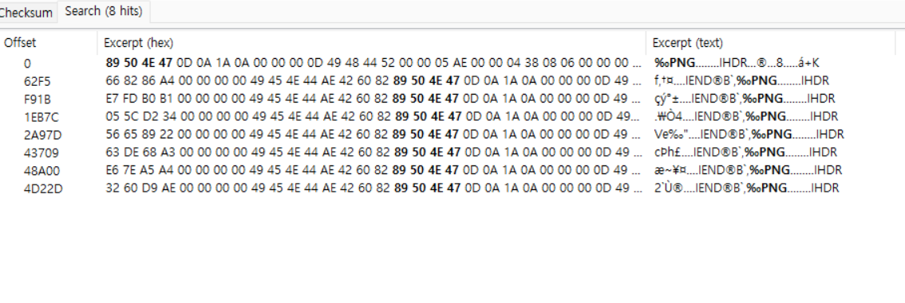
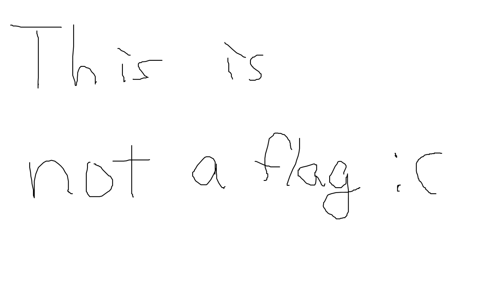
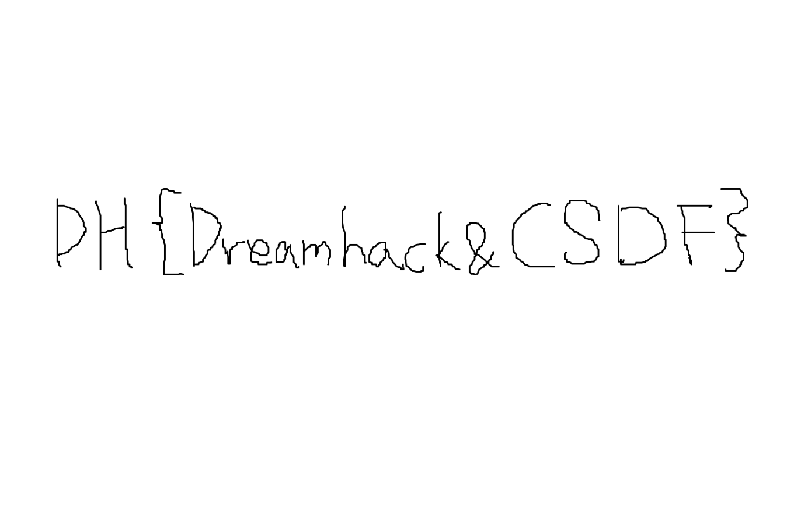
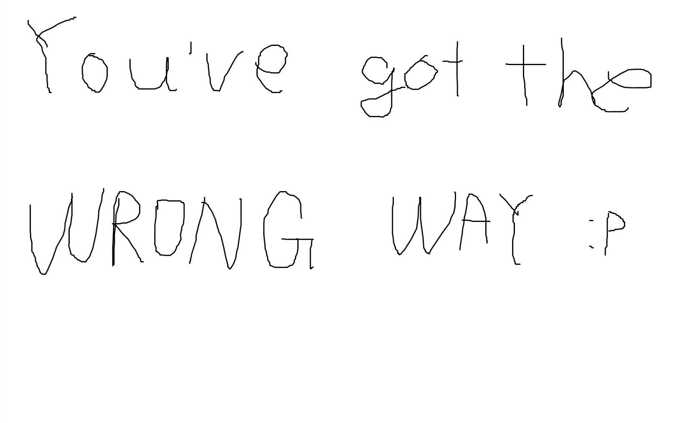

# [Forensics] png_and_png_and_png_and_png

| 항목 | 내용 |
| --- | --- |
| 플랫폼 | Dreamhack 워게임 |
| 문제 URL | https://dreamhack.io/wargame/challenges/2637 |
| 분야 | Forensics |
| 난이도 | B3 |
| 풀이 날짜 | 2026-11-14 |
| 소요 시간 | 15min |
| 핵심 키워드 | PNG 시그니처/`IEND`, 파일 카빙, 이미지 스테가노그래피 |
| CWE | 해당 없음 (포렌식 분석 문제) |

## 1. 문제 개요
제공 파일은 `image.png` 하나(362,181바이트)입니다. 이미지 뷰어로 열면 손글씨로 쓴 **"Digital Forensic :)"** 그림 한 장만 보입니다. 목표는 이 파일에서 플래그(`DH{...}` 형식으로 추정)를 찾는 것입니다.

## 2. 정찰(Recon)
- 사용한 도구: HxD
- 문제 이름(`png_and_png_and_png_and_png`)이 "PNG가 여러 개 이어져 있다"는 힌트로 보여, 파일 전체에서 PNG 시그니처(`89 50 4E 47 0D 0A 1A 0A`)를 검색했습니다.

| 번호 | 시작 오프셋 | 크기(바이트) | 해상도 | 내용(눈으로 확인) |
| --- | --- | --- | --- | --- |
| 0 | `0x0` | 25,333 | 1454×1080 | "Digital Forensic :)" (뷰어에 보이는 그림) |
| 1 | `0x62f5` | 38,438 | 1654×1030 | "Hello !" |
| 2 | `0xf91b` | 62,049 | 1617×1010 | "This is not a flag :(" |
| 3 | `0x1eb7c` | 48,641 | 1384×869 | **`DH{Dreamhack&CSDF}`** |
| 4 | `0x2a97d` | 101,772 | 1645×1014 | "You've got the WRONG WAY :P" |
| 5 | `0x43709` | 21,239 | 722×677 | 손그림(구름 모양 캐릭터) |
| 6 | `0x48a00` | 18,477 | 723×682 | 손그림(고양이 캐릭터, "?") |
| 7 | `0x4d22d` | 46,232 | 1508×1013 | 손그림(왼쪽 아래의 작은 캐릭터) |

- 각 구간 사이에 빈틈이 없고(앞 PNG의 끝 = 다음 PNG의 시작), 8번째 PNG의 `IEND`가 파일의 마지막 바이트입니다.

### 2-2. 파일 카빙(분리)
시그니처 위치를 기준으로 8개를 잘라냅니다.

- 2번 그림은 "This is not a flag :(", 3번은 `DH{Dreamhack&CSDF}`, 4번은 "You've got the WRONG WAY :P"입니다.

## 3. 취약점 분석

## 4. 시도와 실패
| 시도 | 결과 | 배운 점 |
| --- | --- | --- |

## 5. 익스플로잇
1. `file image.png`로 크기와 형식을 확인하고, 첫 `IEND`의 위치(`0x62f5`)가 파일 끝(`0x586c5`)보다 앞에 있음을 확인합니다.
2. PNG 시그니처로 검색해 이어진 PNG 8개를 찾고, 직접 분리합니다(`binwalk`/`foremost` 같은 카빙 도구로도 가능합니다).
3. 분리한 8장을 모두 열어 내용을 확인합니다. 3번 이미지에 `DH{Dreamhack&CSDF}`가 적혀 있습니다.

## 6. 방어 관점

## 7. 탐지 관점

