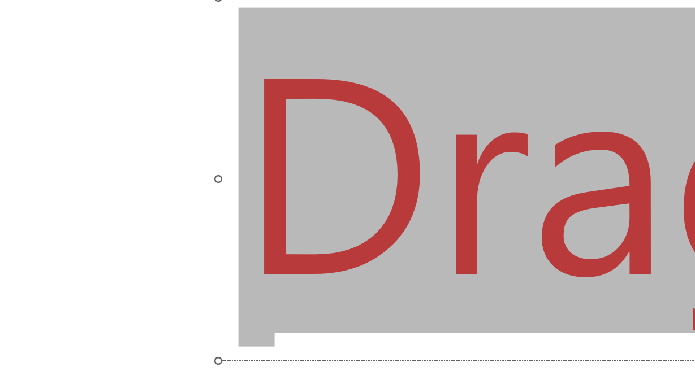
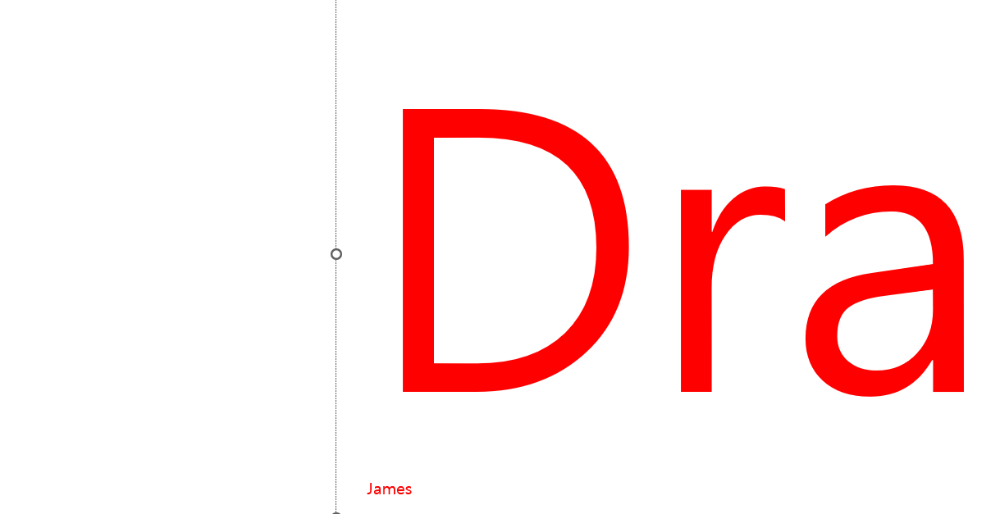
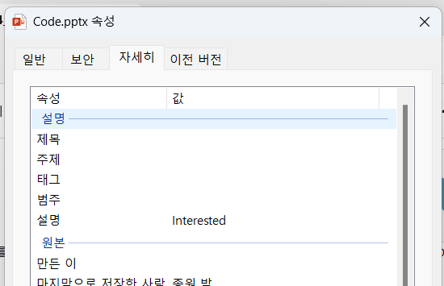
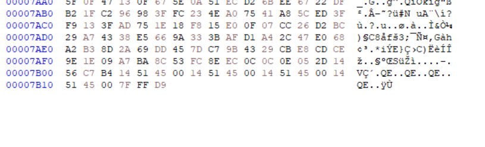

# [Forensics] stegano_whyrano

| 항목 | 내용 |
| --- | --- |
| 플랫폼 | Dreamhack 워게임 |
| 문제 URL | https://dreamhack.io/wargame/challenges/2638 |
| 분야 | Forensics |
| 난이도 | B2 |
| 풀이 날짜 | 2026-11-14 |
| 소요 시간 | 15min |
| 핵심 키워드 | 문서 스테가노그래피, OOXML(.pptx = zip), 파일 시그니처 |
| CWE | 해당 없음 (포렌식 분석 문제) |

## 1. 문제 개요
`Code.pptx` 슬라이드 1장짜리 파일이 주어집니다. 문제 설명은 다음과 같습니다.

> 형형색색의 글자에서 각각 단어를 추리해 플래그를 조합하세요!
> `CODE(()_is_()_in_())`의 각 괄호에 들어갈 내용을 찾은 뒤 .pptx 파일 좌측 상단 양식에 맞추어 입력해주세요!
> 플래그 형식은 `DH{...}`입니다. (예: `CODE(John_is_Dancing_in_Spotlight)` → `DH{John_is_Dancing_in_Spotlight}`)

- 슬라이드 좌측 상단에 `CODE (()_is_()_in_())`이 적혀 있고, 괄호 3개가 **빨강·파랑·초록**으로 칠해져 있습니다.
- 슬라이드에는 이 세 색에 대응하는 단서가 하나씩 있습니다: 빨간 "Drag It!", 파란 "Advanced Properties", 초록 ".JPG" 그림.

## 2. 정찰(Recon)
1. "Drag It!"(빨간 큰 글자) 텍스트 상자의 XML을 보면, 두 번째 문단에 **글자 크기 4pt(`sz="400"`), 색이 배경색(`bg1`)** 인 글자 실행(run)이 들어 있습니다.
- `bg1`은 슬라이드 마스터의 `clrMap`에서 `lt1`로 연결되고, 테마의 `lt1`은 `FFFFFF`(흰색)입니다. 흰 배경에 **흰 글자, 4pt**라서 눈에 보이지 않습니다.
- 빨간 글자 "Drag It!"의 앞부분에서 "드래그하면 튀어나온 부분이 있다"는 단서가 이 글자입니다. 드래그해서 글자색을 바꾸고 크기를 키우면 `James`가 보입니다.

- 빨강 괄호: **`James`**

2. "Advanced Properties"(고급 속성)라는 문구대로 파일 속성을 확인합니다. `속성 → 자세히` 탭 "설명"란에 글자를 확인합니다.

- 파랑 괄호: **`Interested`**

3. 초록 단서는 글자가 아니라 **".JPG"라고 적힌 작은 그림**입니다. 그림 파일이 `.png`인데 내용이 `.JPG`를 암시하므로 확장자와 실제 형식이 다른지 확인합니다.

- `file`은 PNG(168×110)로 인식합니다. 그러나 PNG 청크를 순서대로 읽으면 `IHDR → sRGB → gAMA → pHYs → IDAT → IEND`에서 **끝나는 위치가 `0x693`** 인데 파일 크기는 `0x7b16`입니다. `IEND` 뒤에 29,827바이트가 더 있습니다. 그 뒤 데이터는 `FF D8 FF E0`(JPEG 시작 시그니처)으로 시작해 `FF D9`(JPEG 끝 시그니처)로 끝납니다. 

- 이 구간을 잘라 `.jpg`로 저장하면 974×228 크기의 이미지가 열리고, 초록색 글자 `Chemistry`가 적혀 있습니다.

- 초록 괄호: **`Chemistry`**

## 3. 취약점 분석
| 색 | 은닉 방식 | 왜 눈에 안 띄나 |
| --- | --- | --- |
| 빨강 | 글자색을 배경색과 같게 + 4pt | 슬라이드 위에서 흰 배경에 흰 글자라 보이지 않음 |
| 파랑 | 문서 속성(메모)에 삽입 | 슬라이드 본문에는 없고 속성 창을 열어야 보임 |
| 초록 | PNG의 `IEND` 뒤에 JPEG를 이어 붙임 | 뷰어는 첫 `IEND`까지만 그려서 PNG만 보임 |

## 4. 시도와 실패
| 시도 | 결과 | 배운 점 |

## 5. 익스플로잇
1. `Code.pptx`를 zip으로 압축 해제하여 직접 읽습니다. (`.pptx` → `.zip`으로 이름만 바꿔도 풀립니다.)
2. 빨강: `ppt/slides/slide1.xml`에서 글자 크기가 작고 색이 배경색(`bg1`)인 글자를 찾으면 `James`입니다.
3. 파랑: `속성 → 자세히` 탭 "설명"란을 읽으면 `Interested`입니다.
4. 초록: `ppt/media/image1.png`에서 첫 `IEND`(+CRC 4바이트) 뒤의 데이터를 잘라 `.jpg`로 저장하면 `Chemistry` 그림이 나옵니다.
5. `CODE(James_is_Interested_in_Chemistry)` 양식에 맞춰 `DH{ }`로 감싸 제출합니다.

## 6. 방어 관점

## 7. 탐지 관점

