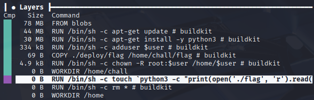

# [Misc] blue-whale

| 항목 | 내용 |
| --- | --- |
| 플랫폼 / 대회 | Dreamhack 워게임 |
| 문제 URL | https://dreamhack.io/wargame/challenges/853 |
| 분야 | Misc (Docker 이미지 포렌식) |
| 난이도 | B1 |
| 풀이 날짜 | 2026-10-29 |
| 소요 시간 | 30min (Docker/dive 환경 구성 트러블슈팅 포함) |
| 핵심 키워드 | Docker 이미지 레이어, dive, 레이어 불변성(immutability), 삭제된 파일 복구 |
| CWE | CWE-212 (Improper Removal of Sensitive Information Before Storage or Transfer) |

## 1. 문제 개요
`dreamhackofficial/blue-whale:1` Docker 이미지가 제공되고, 이 이미지 안에 숨겨진 플래그를 찾는 것이 목표입니다. 이미지를 빌드하는 과정에서 플래그 흔적은 의도적으로 지워졌고 최고 런타임 상태가 아니라 **이미지의 레이어 히스토리 자체**를 분석해야 하는 문제입니다.

## 2. 정찰(Recon)
- `docker pull`로 이미지를 받고 `docker images`로 이미지 ID를 확인합니다.
- `docker history`로 레이어별 실행 명령은 보이지만, 각 레이어에서 실제로 어떤 파일이 생성·삭제됐는지까지는 보이지 않습니다. → 레이어별 파일시스템 스냅샷을 보려면 `dive` 필요.
- `dive` 설치 과정에서 두 번 막힘:
  1. Kali 기본 저장소에 `docker-ce`가 없어 Docker 공식 Debian(bookworm) 저장소를 추가해서 설치.
  2. `dive 6bcfd56d243a` 실행 시 `cannot fetch image / could not find 'blobs/sha256/...' in parsed layers` 에러 발생. `docker save` 후 tar로 다시 시도해도 동일 에러 → 포맷 문제가 아니라 **dive 0.12.0의 알려진 버그**(GitHub 이슈 [#507](https://github.com/wagoodman/dive/issues/507), [#510](https://github.com/wagoodman/dive/issues/510), Docker의 containerd 이미지 포맷 파싱 실패)였음. dive 0.13.1로 업그레이드해 해결.
  
  `curl -LO https://github.com/wagoodman/dive/releases/latest/download/dive_0.13.1_linux_amd64.deb`
  `sudo apt install ./dive_0.13.1_linux_amd64.deb`

- 정상화된 `dive`로 이미지 레이어 목록과 각 레이어의 파일 트리를 확인합니다.

## 3. 취약점 분석
`dive`로 확인한 레이어 구성(요약):

| 레이어 | 명령 | 비고 |
| --- | --- | --- |
| 1 | `FROM` (베이스 이미지) | 78 MB |
| 2~3 | `apt-get update` / `apt-get install -y python3` | |
| 4 | `adduser $user` | |
| 5 | `COPY ./deploy/flag /home/chall/flag` | 69 B — 원본 플래그 파일이 이 레이어에 들어옴 |
| 6 | `chown -R root:$user /home/$user` | |
| 7 | `RUN touch \`python3 -c "print(open('./flag','r').read())"\`` | **flag 파일의 내용을 읽어, 그 문자열 자체를 파일명으로** 하는 0바이트 파일 생성 |
| 8 | `RUN rm *` | 같은 디렉터리의 모든 파일(원본 flag 포함) 삭제 |
| 9 | `WORKDIR /home` | |

7번 레이어처럼 파일을 지우면 최면 이미지(컨테이너 런타임)에는 flag 파일도 흔적도 전혀 남지 않음— `cat`, `grep`을 통한 복원 불가

하지만 Docker 이미지는 레이어를 겹겹이 쌓는 구조이고 **각 레이어는 불변(immutable)이며 전부 이미지 안에 그대로 보존*
즉 다음 레이어에 기록만 추가되고 이전 레이어의 데이터 자체가 지우지 않음.
따라서 7번(touch)의 파일시스템 스냅샷을 보면, 지워지기 전 상태 그대로 플래그 문자열이 파일명으로 확인 가능.

CWE-212(Improper Removal of Sensitive Information Before Storage or Transfer) — 최종 산출물(배포 이미지)에서는 민감정보를 지웠다고 생각했지만, 레이어 기반 저장 구조의 특성 때문에 중간 레이어에 그대로 보존되어 유출로 이어지는 패턴

## 4. 시도와 실패
| 시도 | 결과 | 배운 점 |
| --- | --- | --- |
| `docker run -it`로 컨테이너 접속 후 `find / -name flag`, `cat` 등 | 실패 — 최종 파일시스템에 flag 파일 없음 | 런타임 파일시스템만 봐서는 레이어 중간에 지워진 흔적을 찾을 수 없음 |
| `dive 6bcfd56d243a` (이미지 ID 직접 지정) | `could not find 'blobs/sha256/...' in parsed layers` 에러 | dive 구버전이 Docker containerd 이미지 포맷을 파싱하지 못하는 알려진 버그 |
| `docker save` 후 tar 파일로 dive 재시도 | 동일 에러 재현 | 저장 포맷 문제가 아니라 dive 자체 버전 버그였음을 확인 — 포맷을 바꿔봐도 소용없었음 |
| dive 0.13.1로 업그레이드 후 재시도 | 성공 — 레이어별 파일 트리 정상 표시 | 분석 도구 버전도 CTF 환경 구성의 일부라는 것을 체감 |

## 5. 익스플로잇
1. `dive <이미지ID>`로 레이어 목록을 open.
2. `RUN /bin/sh -c touch \`python3 -c "print(open('./flag','r').read())"\`` 레이어(= `rm *` 바로 이전 레이어)를 선택.
3. 오른쪽 Filetree 패널에서 `/home/chall/` 아래, 플래그 내용이 그대로 파일명으로 찍혀 있는 0바이트 파일을 확인.

## 6. 방어 관점
- **근본 대책**: 민감정보를 생성하고 지우는 작업을 절대 서로 다른 레이어로 나누지 않습니다. `RUN touch ... && rm ...`처럼 **하나의 RUN 안에서 생성과 삭제**를 하면 중간 산출물이 별도 레이어로 분리되어 남지 않습니다. 더 근본적으로는 멀티스테이지 빌드(`FROM ... AS build`)를 사용해, 민감정보를 다루는 스테이지 자체를 최종 이미지에 포함시키지 않습니다.
- **보완 대책**: BuildKit의 `--secret` 마운트를 사용해 민감정보를 빌드 시점에만 메모리상에서 쓰고 레이어에 기록하지 않습니다. 이미지를 레지스트리에 푸시하기 전 CI에서 `docker history`/`dive`로 레이어를 스캔해 민감정보 잔존 여부를 자동 점검합니다.

## 7. 탐지 관점
- CI/CD 파이프라인에 이미지 빌드 직후 `dive --ci` 또는 trufflehog·gitleaks류 시크릿 스캐너를 **레이어 단위**로 돌려, 각 레이어의 파일 트리와 파일명에서 고엔트로피 문자열이나 `flag`/`secret`/`key` 같은 키워드 패턴을 탐지하는 룰을 추가합니다.
- 레지스트리 푸시 이미지에 대해 `docker history --no-trunc` 로그를 분석해, 한 레이어에서 생성한 파일을 바로 다음 레이어에서 삭제(`rm`/`mv`)하는 패턴 자체를 경고하는 정책을 추가합니다.
- 오탐 가능성: 정상적인 빌드 과정(빌드 캐시, 임시 파일 정리 등)에서도 레이어 간 생성→삭제가 흔히 발생하므로, 파일명/내용이 고엔트로피이거나 알려진 시크릿 패턴에 매칭될 때만 알림을 설정합니다.
