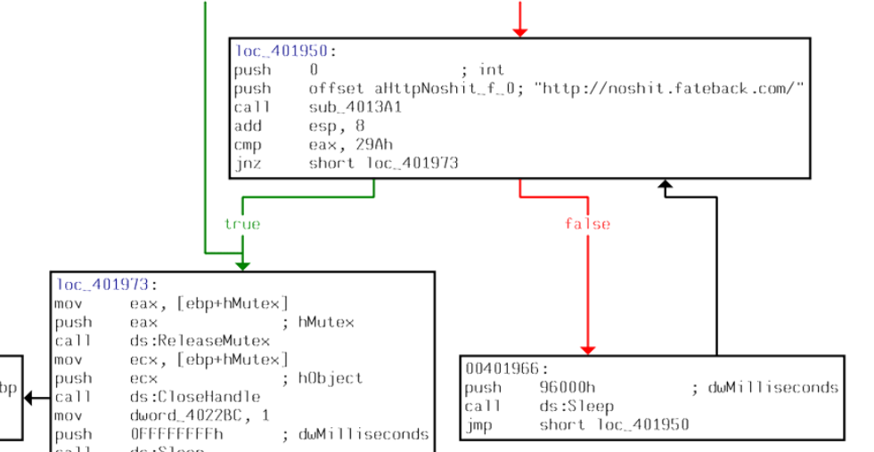
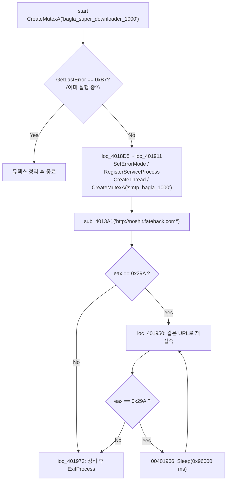
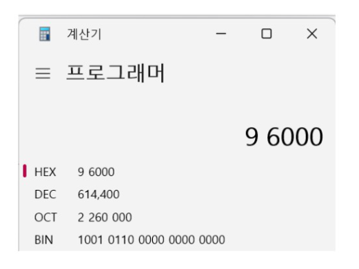

# [Rev] CodeEngn Malware L07

| 항목 | 내용 |
| --- | --- |
| 플랫폼 | Dreamhack 워게임 (CodeEngn Malware L07) |
| 문제 URL | https://dreamhack.io/wargame/challenges/374 |
| 분야 | Rev (악성코드 정적 분석) |
| 난이도 | B4 |
| 풀이 날짜 | 2026-11-4 |
| 소요 시간 | 30min |
| 핵심 키워드 | 정적 분석, IDA 흐름 그래프, 뮤텍스 |
| CWE | 해당 없음 (취약점 문제가 아니라 악성코드 동작 분석 문제) |

## 1. 문제 개요
문제 설명은 다음과 같습니다.

다음은 악성코드 Flow의 일부분이다.  
분석결과 이 악성코드는 특정 사이트에 접속을 시도 하고 있는데 접속이 안될경우 몇초 단위로 재접속을 한다.  
몇ms 단위로 재접속을 하는가?

- 제공 파일은 `07.pdf` 하나이며, 실행 파일이 아니라 IDA가 출력한 `start` 함수의 흐름 그래프입니다.

## 2. 정찰(Recon)
### 2-1. 정적 분석 — 흐름 그래프 읽기

| 블록 | 핵심 코드 | 해석 |
| --- | --- | --- |
| `start` | `CreateMutexA("bagla_super_downloader_1000")` 후 `GetLastError`를 `0B7h`와 비교 | `0xB7` = 183 = `ERROR_ALREADY_EXISTS`. 같은 이름의 뮤텍스가 이미 있으면(=이미 실행 중이면) 뮤텍스를 닫고 종료하는 **중복 실행 방지** 로직입니다 |
| `loc_4018D5` | `SetErrorMode(2)`, `GetProcAddress(kernel32, "RegisterServiceProcess")` | 오류 대화상자를 억제하고, 존재하면 `RegisterServiceProcess(0, 1)`을 호출합니다. 이 API는 프로세스를 서비스로 등록하는 용도입니다(주로 Win9x 계열). 은닉 목적으로 쓴 것으로 추정됩니다 |
| `loc_401911` | `CreateThread(sub_40174C)`, `CreateMutexA("smtp_bagla_1000")`, `sub_4013A1("http://noshit.fateback.com/", 0)` 호출 뒤 `cmp eax, 29Ah` | 스레드 생성 후, 문제에서 말하는 **특정 사이트 접속**을 처음 시도합니다. 반환값을 `0x29A`와 비교해 분기합니다 |
| `loc_401950` | 같은 URL로 `sub_4013A1` 재호출 뒤 `cmp eax, 29Ah` / `jnz loc_401973` | **재접속 루프의 시작점**입니다 |
| `00401966` | `push 96000h` → `call ds:Sleep` → `jmp loc_401950` | 접속이 실패했을 때 `Sleep`으로 대기한 뒤 `loc_401950`으로 돌아가 다시 접속합니다 |
| `loc_401973` | `ReleaseMutex`, `CloseHandle`, `Sleep(0xFFFFFFFF)`, `ExitProcess(0)` | 반환값이 `29Ah`가 아닐 때(`jnz` true) 도달하는 종료 경로입니다 |



### 요청 흐름 정리



## 3. 취약점 분석
이 문제는 소프트웨어 취약점이 아니라 **악성코드의 동작(C2 접속 및 재시도 로직) 분석**입니다. 분석으로 얻은 정보는 다음과 같습니다.

- **접속 대상**: `http://noshit.fateback.com/`. 다운로더로 보이는 이름(`bagla_super_downloader_1000`)과 함께, 외부 서버에 HTTP로 접속해 다음 동작을 받는 구조로 보입니다.
- **재시도 주기**: `Sleep(0x96000)` ms. 실패 시 일정 간격으로 되풀이하므로 **네트워크 상에서 규칙적인 주기를 띠는 비콘(beacon) 트래픽**이 됩니다. 이 주기성이 탐지 단서가 됩니다.
- **식별 지표(IOC)**: 뮤텍스 `bagla_super_downloader_1000`, `smtp_bagla_1000`, 도메인 `noshit.fateback.com`, 임포트 `RegisterServiceProcess`.
- 위험도: 이 샘플은 2006년 무렵의 구형 악성코드로 보이며 현재 환경에서 직접 위협이 되는 정도는 낮습니다. 다만 "뮤텍스로 중복 실행 방지 + 실패 시 고정 간격 재시도"는 지금도 흔한 패턴이라 교육용 사례로 가치가 있습니다.
- ATT&CK 매핑(추정): T1071.001(Web Protocols를 통한 C2 통신). 다운로더 동작이 확인되면 T1105(Ingress Tool Transfer)도 해당됩니다. 이 문제에서는 다운로드 코드가 그래프에 없어서 확정하지 못했습니다.

## 4. 시도와 실패
실제 시행착오가 아니라, 이 문제를 풀 때 오답으로 이어지기 쉬운 지점을 정리한 표입니다.

| 시도 | 결과 | 배운 점 |
| --- | --- | --- |
| 첫 접속 블록(`loc_401911`)에서 대기 시간을 찾으려 함 | 못 찾음 | 첫 블록에는 `Sleep`이 없습니다. 재시도 대기는 접속 실패 분기(`00401966`)에만 있으므로 **분기 방향**을 따라가야 합니다 |

## 5. 익스플로잇
악성코드 분석 문제라 익스플로잇 대신 풀이 절차를 정리합니다.

1. `07.pdf`를 열어 `start` 함수의 흐름 그래프를 확인합니다. 파일이 PDF이고 코드를 실행할 필요가 없으므로 정적 분석 문제입니다.
2. 문제 설명의 "특정 사이트에 접속"에 해당하는 `http://noshit.fateback.com/` 문자열과 `sub_4013A1` 호출 블록(`loc_401950`)을 찾습니다.
3. 이 블록에서 `eax == 0x29A`(접속 실패로 추정)일 때 이어지는 `00401966`을 따라가면 `push 96000h` → `call ds:Sleep` → `jmp loc_401950` 순으로 **대기 후 재접속**하는 루프를 확인할 수 있습니다.
4. `Sleep`의 인자는 밀리초이므로 `0x96000`을 10진수로 변환합니다. 계산기(프로그래머 모드)의 HEX 칸에 `96000`을 넣으면 DEC가 `614,400`입니다.

   ```text
   0x96000 = 9×16^4 + 6×16^3 = 589,824 + 24,576 = 614,400 (ms)
   → 614.4초 ≈ 10.24분 간격으로 재접속
   ```

   ```python
   >>> 0x96000
   614400
   ```



### 보충 — 생성형 AI 활용 풀이
본 문제의 정적 분석은 생성형 AI를 이용하여 풀었습니다. 프롬프트는 문제 설명과 그래프 이미지를 같이 주고 "재접속 간격을 16진수에서 10진수로 변환"해 달라고 하는 형태였고, AI의 답은 다음 순서였습니다.

1. `loc_401966` 블록에서 `Sleep(96000h)` → `jmp loc_401950`의 재접속 루프를 찾았고,
2. `0x96000 = 614,400 ms`로 변환했으며,
3. `Sleep`의 인자가 초가 아니라 밀리초라는 오해 가능성까지 짚었습니다.

AI 답변은 **그래프의 분기 방향과 16진수 변환 결과를 사람이 한 번 더 검증**해야 합니다. 특히 `29Ah` 분기가 "실패" 쪽인지는 `sub_4013A1`의 내부 코드 없이 구조로만 판단한 추정이라, AI의 설명을 그대로 믿지 않고 `jnz`의 true/false 방향을 직접 확인하는 것이 안전합니다.

## 6. 방어 관점
- **근본 대책(유입 차단)**: 악성코드가 시스템에 들어오지 못하게 하는 것이 우선입니다. 출처가 불분명한 실행 파일 차단, 이메일 첨부·다운로드 파일의 샌드박스 검사, 애플리케이션 화이트리스트(실행 허용 목록)를 적용합니다.
- **보완 대책(통신 차단·격리)**:
  - 알려진 C2 도메인 `noshit.fateback.com`을 DNS/프록시 단에서 차단합니다. 무료 호스팅 도메인은 평판 기반 차단 정책으로 걸러내는 것도 방법입니다.
  - 서버·업무 PC의 아웃바운드 HTTP를 프록시로 한정하고, 프록시를 거치지 않는 직접 외부 접속을 막습니다.
  - 감염이 의심되면 해당 PC를 네트워크에서 분리한 뒤, 아래 IOC로 동일 흔적이 있는 다른 PC를 찾습니다.
  - IOC 뮤텍스를 정상 프로그램이 만들 가능성은 낮으므로, EDR에서 뮤텍스 이름 기반 탐지 규칙을 추가할 수 있습니다.

## 7. 탐지 관점
이 샘플의 특징은 **고정 URL + 고정 주기(614.4초)의 재접속**입니다. 네트워크 로그에서 도메인과 주기성을 함께 보는 것이 효과적입니다.

- **DNS/프록시 로그 탐지 (Sigma 스타일 초안)**
  ```yaml
  title: 알려진 C2 도메인(noshit.fateback.com) 질의 또는 접속
  logsource:
    category: dns
  detection:
    selection:
      query|endswith: 'noshit.fateback.com'
    condition: selection
  level: high
  ```
- **오탐 가능성과 완화**: 정상 프로그램도 접속 실패 시 고정 간격으로 재시도하므로(업데이트 확인 등) **주기성만으로는 오탐이 많습니다.** 도메인 평판, 프로세스 정보(서명 여부, 실행 경로), 뮤텍스 이름 같은 IOC와 함께 상관분석하면 줄일 수 있습니다. 도메인 룰은 이미 알려진 지표라서 오탐은 거의 없지만, 도메인이 바뀌면 놓칩니다.
