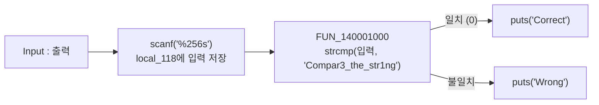
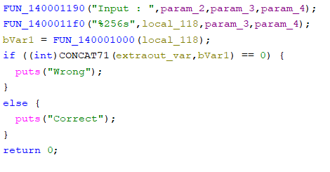
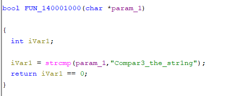
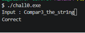

# [Rev] rev-basic-0

| 항목 | 내용 |
| --- | --- |
| 플랫폼 | Dreamhack 워게임 |
| 문제 URL | https://dreamhack.io/wargame/challenges/14 |
| 분야 | Rev |
| 난이도 | Level 1 |
| 풀이 날짜 | 2026-11-7 |
| 소요 시간 | 5min |
| 핵심 키워드 | 정적 분석, Ghidra |
| CWE | CWE-798 (Use of Hard-coded Credentials), CWE-259 (Use of Hard-coded Password) |

## 1. 문제 개요
Windows 실행 파일 `chall0.exe` 하나가 주어집니다. 실행하면 `Input : `을 출력하고 문자열을 입력받은 뒤, 올바른 입력이면 `Correct`, 아니면 `Wrong`을 출력합니다. 목표는 `Correct`가 출력되는 입력값을 찾아 플래그로 제출하는 것입니다. (플래그 형식 `DH{...}`)

## 2. 정찰(Recon)
- 파일 형식: PE32+ (x86-64, 콘솔 프로그램). 심볼이 없어서 함수 이름은 Ghidra가 붙인 `FUN_<주소>` 형태입니다.
- 사용한 도구: Ghidra (디컴파일러, 문자열 목록, 상호 참조).
- 바이너리를 **실행하지 않고** 정적 분석만으로 풀었습니다.

### 2-1. 정적 분석
Ghidra를 통해 원하는 목표값이 correct가 호출되는 지점을 찾았습니다.
```c
// FUN_140001100
  bVar1 = FUN_140001000(local_118);
  if ((int)CONCAT71(extraout_var,bVar1) == 0) {
    puts("Wrong");
  }
  else {
    puts("Correct");
  }
  return 0;
}
```

```c
bool FUN_140001000(char *param_1)
{
  int iVar1;
  iVar1 = strcmp(param_1, "Compar3_the_str1ng");
  return iVar1 == 0;
}
```

- 입력을 `local_118`(256바이트)에 받아 `FUN_140001000`에 넘기고, 이 함수는 입력과 하드코딩된 문자열을 `strcmp`로 비교해 일치 여부만 돌려줍니다.
- 변환이나 연산 없이 **문자열 그대로** 비교합니다.

### 검증 흐름



## 3. 취약점 분석
- **근본 원인**: 정답 문자열이 바이너리의 `.rdata` 영역에 평문으로 들어 있습니다. 검증 로직이 입력과 이 상수를 `strcmp`로 비교하는 것이 전부라서, 문자열만 꺼내면 비교 과정을 몰라도 통과 값을 알 수 있습니다.
- 공격 조건은 바이너리 파일만 있으면 되고 디컴파일러나 문자열 추출 도구로 충분하므로 난이도는 매우 낮습니다. 영향은 검증 로직 전체의 무력화입니다.
- CWE-798 / CWE-259 (하드코딩된 자격 증명·비밀번호).

## 4. 시도와 실패
| 시도 | 결과 | 배운 점 |
| --- | --- | --- |

## 5. 익스플로잇
1. Ghidra로 `chall0.exe`를 열고 목표값인 `Correct`를 찾습니다.



2. Correct와 Wrong을 구분하기 위한 함수인 FUN_140001000을 찾습니다.



3. 프로그램에 해당 문자열을 입력하면 `Correct`가 출력됩니다. 플래그 형식에 맞춰 `DH{ }`로 감싸 제출합니다.



## 6. 방어 관점
- **근본 대책**: 비밀 값을 바이너리에 평문으로 넣어 두고 비교하는 방식은 어떤 구현이든 정적 분석으로 뚫립니다. 인증이 필요하면 **서버 측 검증**으로 옮기고, 클라이언트에는 정답 비교 로직을 두지 않습니다. 로컬 검증이 꼭 필요하면 정답 자체 대신 **솔트를 적용한 해시**만 저장합니다.
  ```c
  /* 기존(취약) — 정답 평문이 바이너리에 그대로 존재 */
  return strcmp(input, "Compar3_the_str1ng") == 0;

  /* 개선 — 솔트+해시 값만 보관(예시: 의사 코드) */
  compute_kdf(input, SALT, sizeof SALT, digest);      // PBKDF2/scrypt 등
  return constant_time_compare(digest, STORED_DIGEST, sizeof digest);
  ```

## 7. 탐지 관점

