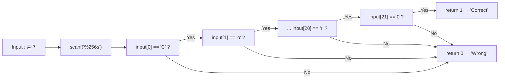
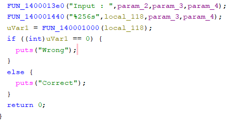
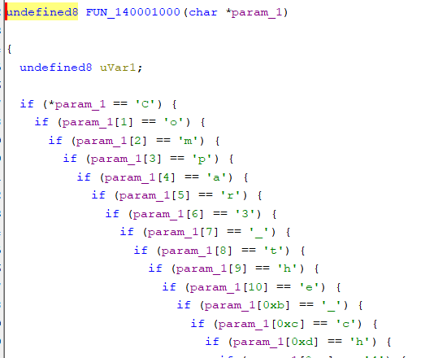
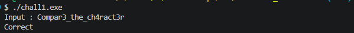

# [Rev] rev-basic-1

| 항목 | 내용 |
| --- | --- |
| 플랫폼 | Dreamhack 워게임 |
| 문제 URL | https://dreamhack.io/wargame/challenges/15 |
| 분야 | Rev |
| 난이도 | B4 |
| 풀이 날짜 | 2026-11-7 |
| 소요 시간 | 5min |
| 핵심 키워드 | 정적 분석, 디스어셈블리, 바이트 단위 비교, 문자열 복원 |
| CWE | CWE-798 (Use of Hard-coded Credentials), CWE-259 (Use of Hard-coded Password) |

## 1. 문제 개요
Windows 실행 파일 `chall1.exe` 하나가 주어집니다. 실행하면 `Input : `을 출력하고 문자열을 입력받은 뒤, 올바른 입력이면 `Correct`, 아니면 `Wrong`을 출력합니다. 목표는 `Correct`가 출력되는 입력값을 찾아 플래그로 제출하는 것입니다. (플래그 형식 `DH{...}`)

## 2. 정찰(Recon)
- 파일 형식: PE32+ (x86-64, 콘솔 프로그램). 심볼이 없어서 함수 이름은 Ghidra가 붙인 `FUN_<주소>` 형태입니다.
- 사용한 도구: Ghidra (디컴파일러, 문자열 목록, 상호 참조).
- 바이너리를 **실행하지 않고** 정적 분석만으로 풀었습니다.

### 2-1. 정적 분석
Ghidra를 통해 원하는 목표값이 correct가 호출되는 지점을 찾았습니다.
```c
// FUN_140001350
  uVar1 = FUN_140001000(local_118);
  if ((int)uVar1 == 0) {
    puts("Wrong");
  }
  else {
    puts("Correct");
  }
  return 0;
}
```

```c
undefined8 FUN_140001000(char *param_1)
{
  undefined8 uVar1;
  
  if (*param_1 == 'C') {
    if (param_1[1] == 'o') {
      if (param_1[2] == 'm') {
        ... }
      else {
        uVar1 = 0;
      }
    }
    else {
      uVar1 = 0;
    }
  }
  else {
    uVar1 = 0;
  }
  return uVar1;
}
```

- 입력을 `local_118`(256바이트)에 받아 `FUN_140001000`에 넘기고, 이 함수는 입력과 하드코딩된 문자를 인덱스로 비교해 일치 여부만 돌려줍니다.
- 변환이나 연산 없이 **문자 그대로** 비교합니다.

| 인덱스 | 0 | 1 | 2 | 3 | 4 | 5 | 6 | 7 | 8 | 9 | 10 | 11 | 12 | 13 | 14 | 15 | 16 | 17 | 18 | 19 | 20 | 21 |
| --- | --- | --- | --- | --- | --- | --- | --- | --- | --- | --- | --- | --- | --- | --- | --- | --- | --- | --- | --- | --- | --- | --- |
| 문자 | `C` | `o` | `m` | `p` | `a` | `r` | `3` | `_` | `t` | `h` | `e` | `_` | `c` | `h` | `4` | `r` | `a` | `c` | `t` | `3` | `r` | `\0` |

인덱스 0~20이 모두 추출되었고, 이어붙이면 `Compar3_the_ch4ract3r`입니다.

### 검증 흐름



## 3. 취약점 분석
- **근본 원인**: 정답 문자열을 한 덩어리로 두지 않고 **문자 하나씩 상수와 비교**하도록 컴파일된 형태입니다. 그러나 비교 상수가 명령어 안에 즉치값(immediate)으로 그대로 들어 있어서, `strings`에는 안 보여도 디스어셈블리를 읽으면 그대로 복원됩니다.
- CWE-798 / CWE-259 (하드코딩된 자격 증명·비밀번호).

## 4. 시도와 실패
| 시도 | 결과 | 배운 점 |
| --- | --- | --- |

## 5. 익스플로잇
1. Ghidra로 `chall1.exe`를 열고 목표값인 `Correct`를 찾습니다.



2. Correct와 Wrong을 구분하기 위한 함수인 FUN_140001000을 찾습니다.



3. 프로그램에 해당 문자열을 입력하면 `Correct`가 출력됩니다. 플래그 형식에 맞춰 `DH{ }`로 감싸 제출합니다.



## 6. 방어 관점
- **근본 대책**: 
## 6. 방어 관점
- **근본 대책**: 비밀 값을 바이너리에 평문으로 넣어 두고 비교하는 방식은 어떤 구현이든 정적 분석으로 뚫립니다. 인증이 필요하면 **서버 측 검증**으로 옮기고, 클라이언트에는 정답 비교 로직을 두지 않습니다. 로컬 검증이 꼭 필요하면 정답 자체 대신 **솔트를 적용한 해시**만 저장하고 **상수 시간 비교**를 씁니다.
  ```c
  /* 기존(취약) — 문자 단위 비교, 정답이 명령어 상수로 노출, 첫 불일치에서 즉시 반환 */
  if (input[0] != 'C') return 0;
  if (input[1] != 'o') return 0;
  /* ... */

  /* 개선 — 솔트+해시만 보관, 상수 시간 비교 (의사 코드) */
  compute_kdf(input, SALT, sizeof SALT, digest);      // PBKDF2/scrypt 등
  return constant_time_compare(digest, STORED_DIGEST, sizeof digest);
  ```
- **보완 대책**:
  - 입력 길이는 `%255s`처럼 버퍼 크기보다 1 작게 제한하거나 `fgets`를 사용해 널 문자 공간을 확보합니다. (이 프로그램은 `%256s`입니다. 버퍼 크기는 이 문제에서 확인하지 않았습니다.)
  - 코드 난독화는 분석을 늦출 뿐 근본 해결이 아닙니다. 시간 지연용 보조 수단으로만 취급합니다.

## 7. 탐지 관점
이 문제는 네트워크 공격이 아니라 **바이너리 안의 하드코딩된 비밀**이 원인이라서, 런타임 로그보다 빌드·배포 단계의 코드와 산출물 점검이 맞습니다.

- **정적 분석(SAST) 룰 초안**: 입력 문자열의 고정 인덱스를 문자 리터럴과 연속으로 비교하는 패턴을 탐지합니다.
  ```yaml
  # Semgrep 스타일 초안
  rules:
    - id: hardcoded-secret-char-compare
      languages: [c, cpp]
      severity: WARNING
      message: 입력 문자열을 문자 리터럴과 한 글자씩 비교해 하드코딩된 비밀을 검증하고 있습니다 (CWE-798, CWE-259)
      patterns:
        - pattern: |
            if ($INPUT[$I] != '$C') return 0;
            if ($INPUT[$J] != '$D') return 0;
  ```
- **산출물 점검**: 릴리스 바이너리에서 `strings`만으로는 이런 형태를 찾지 못합니다. 디스어셈블리에서 `cmp reg, imm`이 인덱스를 바꿔 가며 길게 이어지는 패턴을 찾는 정적 분석 단계를 CI에 추가할 수 있습니다.
- **오탐 가능성과 완화**: 파서나 프로토콜 처리 코드는 `buf[i] == '<'` 같은 문자 비교가 정상적으로 많이 나옵니다. 이 룰은 비교 대상 변수명이 `password`, `key`, `token`이거나 인증 함수 내부일 때만 경고하도록 범위를 좁히는 것이 좋습니다. 위 Semgrep 룰은 문법 검증을 하지 않은 초안입니다.
