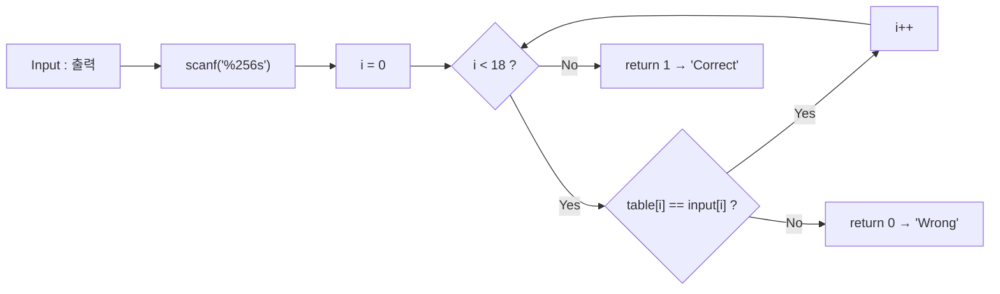
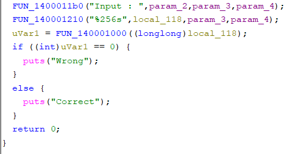
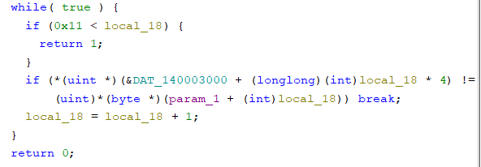
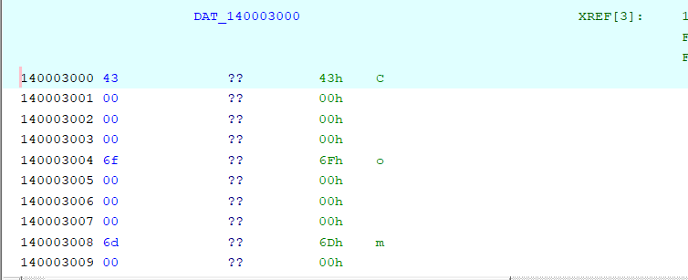
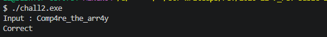

# [Rev] rev-basic-2

| 항목 | 내용 |
| --- | --- |
| 플랫폼 | Dreamhack 워게임 |
| 문제 URL | https://dreamhack.io/wargame/challenges/16 |
| 분야 | Rev |
| 난이도 | Level 1 |
| 풀이 날짜 | 2026-11-7 |
| 소요 시간 |  |
| 핵심 키워드 | 정적 분석, 디스어셈블리, 데이터 테이블(배열) 비교, 반복문 |
| CWE | CWE-798 (Use of Hard-coded Credentials), CWE-259 (Use of Hard-coded Password) |

## 1. 문제 개요
Windows 실행 파일 `chall2.exe` 하나가 주어집니다. 실행하면 `Input : `을 출력하고 문자열을 입력받은 뒤, 올바른 입력이면 `Correct`, 아니면 `Wrong`을 출력합니다. 목표는 `Correct`가 출력되는 입력값을 찾아 플래그로 제출하는 것입니다. (플래그 형식 `DH{...}`)

## 1. 문제 개요
Windows 실행 파일 `chall1.exe` 하나가 주어집니다. 실행하면 `Input : `을 출력하고 문자열을 입력받은 뒤, 올바른 입력이면 `Correct`, 아니면 `Wrong`을 출력합니다. 목표는 `Correct`가 출력되는 입력값을 찾아 플래그로 제출하는 것입니다. (플래그 형식 `DH{...}`)

## 2. 정찰(Recon)
- 파일 형식: PE32+ (x86-64, 콘솔 프로그램). 심볼이 없어서 함수 이름은 Ghidra가 붙인 `FUN_<주소>` 형태입니다.
- 사용한 도구: Ghidra (디컴파일러, 문자열 목록, 상호 참조).
- 바이너리를 **실행하지 않고** 정적 분석만으로 풀었습니다.

### 2-1. 정적 분석
Ghidra를 통해 원하는 목표값이 correct가 호출되는 지점을 찾았습니다.
```c
// FUN_140001120
  uVar1 = FUN_140001000(local_118);
  if ((int)uVar1 == 0) {
    puts("Wrong");
  }
  else {
    puts("Correct");
  }
  return 0;
}
```

```c
undefined8 FUN_140001000(longlong param_1){
  while( true ) {
    if (0x11 < local_18) {
      return 1;
    }
    if (*(uint *)(&DAT_140003000 + (longlong)(int)local_18 * 4) !=
        (uint)*(byte *)(param_1 + (int)local_18)) break;
    local_18 = local_18 + 1;
  }
}
```

- 입력을 `local_118`(256바이트)에 받아 `FUN_140001000`에 넘기고, 이 함수는 입력과 DAT_140003000에 저장된 값을 인덱스로 비교해 일치 여부만 돌려줍니다.
- 변환이나 연산 없이 **문자 그대로** 비교합니다.

| 인덱스 | 0 | 1 | 2 | 3 | 4 | 5 | 6 | 7 | 8 | 9 | 10 | 11 | 12 | 13 | 14 | 15 | 16 | 17 |
| --- | --- | --- | --- | --- | --- | --- | --- | --- | --- | --- | --- | --- | --- | --- | --- | --- | --- | --- |
| 값 | `0x43` | `0x6f` | `0x6d` | `0x70` | `0x34` | `0x72` | `0x65` | `0x5f` | `0x74` | `0x68` | `0x65` | `0x5f` | `0x61` | `0x72` | `0x72` | `0x34` | `0x79` | `0x00` |
| 문자 | `C` | `o` | `m` | `p` | `4` | `r` | `e` | `_` | `t` | `h` | `e` | `_` | `a` | `r` | `r` | `4` | `y` | `\0` |

- 인덱스 0~16을 이어붙이면 `Comp4re_the_arr4y`입니다.

### 검증 흐름



## 3. 취약점 분석
- **근본 원인**: 정답을 `.data` 영역의 배열로 그대로 보관하고 입력과 직접 비교합니다. 문자열이 아니라 **4바이트 정수 배열**이라서 `strings`에는 걸리지 않지만, 비교 대상 주소를 따라가 값을 읽으면 그대로 복원됩니다.
- CWE-798 / CWE-259 (하드코딩된 자격 증명·비밀번호)

## 4. 시도와 실패
| 시도 | 결과 | 배운 점 |
| --- | --- | --- |

## 5. 익스플로잇
1. Ghidra로 `chall2.exe`를 열고 목표값인 `Correct`를 찾습니다.



2. Correct와 Wrong을 구분하기 위한 함수인 FUN_140001000을 찾습니다.



3. DAT_140003000에 저장된 정보를 확인합니다.




4. 프로그램에 해당 문자열을 입력하면 `Correct`가 출력됩니다. 플래그 형식에 맞춰 `DH{ }`로 감싸 제출합니다.



## 6. 방어 관점
- **근본 대책**: 클라이언트 쪽 바이너리에 정답이나 정답을 복원할 수 있는 값을 넣어 두면 문자열이든 배열이든 정적 분석으로 뚫립니다. 인증은 **서버 측 검증**으로 옮기고, 로컬 검증이 꼭 필요하면 정답 대신 **솔트를 적용한 해시**를 저장하고 **상수 시간 비교**를 씁니다.
  ```c
  /* 기존(취약) — 정답 배열이 .data에 그대로 존재, 첫 불일치에서 즉시 반환 */
  for (int i = 0; i < 18; i++)
      if (table[i] != input[i]) return 0;
  return 1;

  /* 개선 — 솔트+해시만 보관, 상수 시간 비교 (의사 코드) */
  compute_kdf(input, SALT, sizeof SALT, digest);      // PBKDF2/scrypt 등
  return constant_time_compare(digest, STORED_DIGEST, sizeof digest);
  ```

## 7. 탐지 관점
