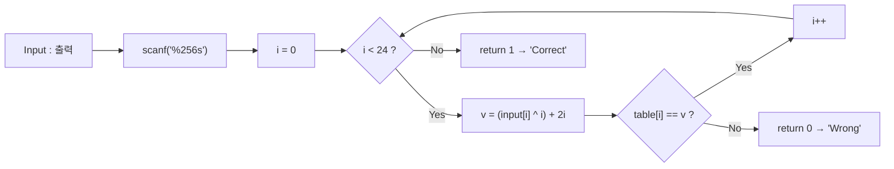
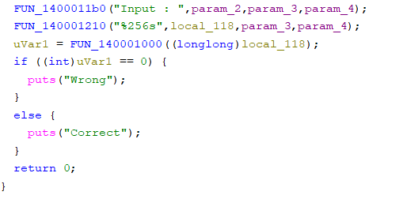
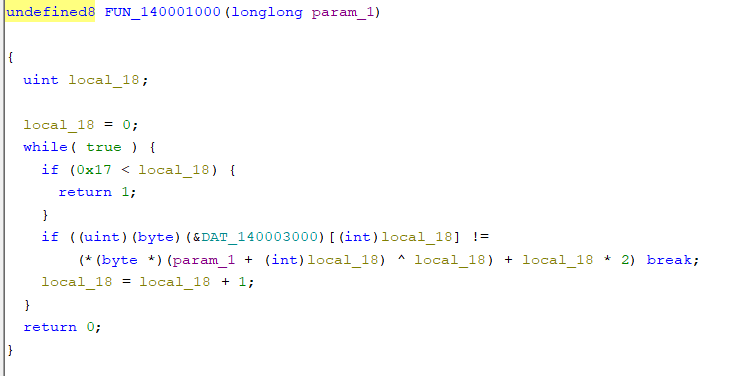
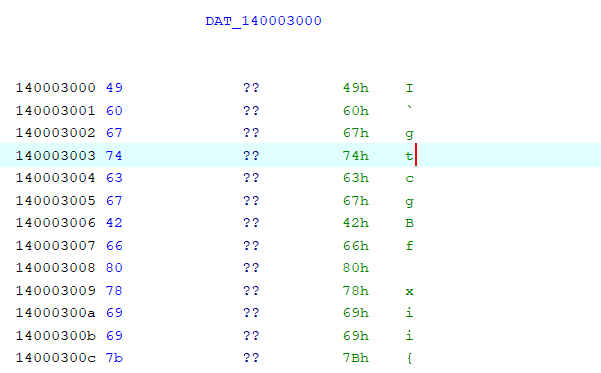
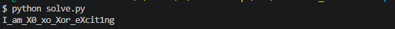
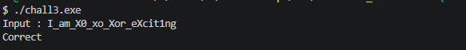

# [Rev] rev-basic-3

| 항목 | 내용 |
| --- | --- |
| 플랫폼 | Dreamhack 워게임 |
| 문제 URL | https://dreamhack.io/wargame/challenges/17 |
| 분야 | Rev |
| 난이도 | B4 |
| 풀이 날짜 | 2026-11-7 |
| 소요 시간 | 15min |
| 핵심 키워드 | 정적 분석, 디스어셈블리, XOR, 역연산, 데이터 테이블 |
| CWE | CWE-798 (Use of Hard-coded Credentials), CWE-327 (Use of a Broken or Risky Cryptographic Algorithm) |

## 1. 문제 개요
Windows 실행 파일 `chall3.exe` 하나가 주어집니다. 실행하면 `Input : `을 출력하고 문자열을 입력받은 뒤, 올바른 입력이면 `Correct`, 아니면 `Wrong`을 출력합니다. 목표는 `Correct`가 출력되는 입력값을 찾아 플래그로 제출하는 것입니다. (플래그 형식 `DH{...}`)

## 2. 정찰(Recon)
- 파일 형식: PE32+ (x86-64, 콘솔 프로그램). 심볼이 없어서 함수 이름은 Ghidra가 붙인 `FUN_<주소>` 형태입니다.
- 사용한 도구: Ghidra (디컴파일러, 문자열 목록, 상호 참조).
- 바이너리를 **실행하지 않고** 정적 분석만으로 풀었습니다.

### 2-1. 정적 분석
Ghidra를 통해 원하는 목표값이 correct가 호출되는 지점을 찾았습니다.
```c
// FUN_140001120
  uVar1 = FUN_140001000((longlong)local_118);
  if ((int)uVar1 == 0) {
    puts("Wrong");
  }
  else {
    puts("Correct");
  }
  return 0;
}
```

```c
undefined8 FUN_140001000(longlong param_1)
{
  uint local_18;
  
  local_18 = 0;
  while( true ) {
    if (0x17 < local_18) {
      return 1;
    }
    if ((uint)(byte)(&DAT_140003000)[(int)local_18] !=
        (*(byte *)(param_1 + (int)local_18) ^ local_18) + local_18 * 2) break;
    local_18 = local_18 + 1;
  }
  return 0;
}
```

### 2-2. 역연산으로 입력 복원
검증식이 `table[i] = (input[i] ^ i) + 2i` 형태라서, 연산을 거꾸로 하면 `input[i]`가 하나로 정해집니다.

| 단계 | 식 |
| --- | --- |
| 검증식 | `table[i] = (input[i] ^ i) + 2i` |
| 덧셈 제거 | `input[i] ^ i = table[i] - 2i` |
| XOR 제거 | `input[i] = (table[i] - 2i) ^ i` |

XOR은 같은 값으로 한 번 더 XOR하면 원래 값이 돌아오고, 덧셈은 뺄셈으로 되돌립니다. 적용 순서는 검증식의 반대(덧셈 제거 → XOR 제거)입니다.

### 2-3. flag가 저장된 위치 확인
복원에 쓸 `table`이 **어디에 있는지**를 ①어셈블리 분석으로 메모리 주소를 구하고, ②파이썬으로 그 주소를 파일 오프셋으로 변환하는 두 단계로 확인했습니다.

#### ① 어셈블리 분석 — `lea`의 `rip` 상대 주소 계산
검증 함수(`FUN_140001000`)는 비교할 때마다 테이블의 주소를 `lea`로 가져옵니다.

```asm
140001028  48 8d 0d d1 1f 00 00   lea    rcx, [rip+0x1fd1]        ; 테이블의 시작 주소
14000102f  0f b6 04 01            movzx  eax, byte ptr [rcx+rax]  ; eax = table[i]  (1바이트씩)
```

- `lea`의 오프셋은 기계어 바이트 `d1 1f 00 00`을 리틀 엔디언으로 읽은 `0x1fd1`입니다.
- x86-64의 `rip` 상대 주소는 **다음 명령어의 주소**를 기준으로 계산합니다. `lea`가 7바이트이므로 다음 명령어는 `0x14000102f`입니다.

  ```text
  0x14000102f + 0x1fd1 = 0x140003000
  ```

- 이어지는 `[rcx+rax]`에는 `*4` 같은 배율이 없으므로 원소는 1바이트이고, 앞의 `cmp rax, 0x18`로 24개를 읽는다는 것을 알 수 있습니다.
- 이 주소가 어느 섹션인지는 섹션 헤더로 확인합니다. `0x140003000`은 `.data`(`0x140003000`~`0x140003657`, 읽기/쓰기)의 시작입니다. 이 주소를 파일 오프셋으로 바꾸는 과정은 ②에서 설명합니다.

#### ② 파이썬 계산 — 가상 주소(VA)를 파일 오프셋 `0x2400`으로 변환
①에서 얻은 `0x140003000`은 **메모리에 로드됐을 때의 주소(VA)** 입니다. 스크립트는 디스크에 있는 파일을 읽으므로, 이 주소가 **파일의 몇 번째 바이트**인지 바꿔야 합니다. PE는 섹션마다 "메모리 위치"와 "파일 위치"가 다르기 때문에, 섹션 헤더의 값을 이용해 변환합니다.

계산은 세 단계입니다.

| 단계 | 식 | 값 |
| --- | --- | --- |
| ① 이미지 기준 주소 제거 (VA → RVA) | `0x140003000 - 0x140000000` | `0x3000` |
| ② RVA가 속한 섹션 찾기 | `.data`: `0x3000 <= rva < 0x3658` | `.data` |
| ③ 섹션 안에서의 거리를 파일 위치에 더하기 | `0x3000 - 0x3000 + PointerToRawData(0x2400)` | **`0x2400`** |

`pefile`로 출력한 섹션 표에서 해당 값을 확인했습니다.

| 섹션 | RVA 범위 | PointerToRawData |
| --- | --- | --- |
| `.text` | `0x1000` ~ `0x2000` | `0x400` |
| `.rdata` | `0x2000` ~ `0x3000` | `0x1400` |
| **`.data`** | **`0x3000` ~ `0x3658`** | **`0x2400`** |
| `.pdata` | `0x4000` ~ `0x4200` | `0x2600` |

위에서 구한 위치(`.data`, `0x140003000` = 파일 오프셋 `0x2400`, 24바이트)에서 바이트를 읽어 역연산한 코드입니다.

```python
#!/usr/bin/env python3
with open('chall3.exe', 'rb') as f:
    d = f.read()

table = d[0x2400:0x2400 + 24]

flag = bytes(((table[i] - 2 * i) & 0xff) ^ i for i in range(24))
print(flag.decode())

```

테이블의 값과 복원 결과는 다음과 같습니다.

| i | 0 | 1 | 2 | 3 | 4 | 5 | 6 | 7 | 8 | 9 | 10 | 11 |
| --- | --- | --- | --- | --- | --- | --- | --- | --- | --- | --- | --- | --- |
| table[i] | `0x49` | `0x60` | `0x67` | `0x74` | `0x63` | `0x67` | `0x42` | `0x66` | `0x80` | `0x78` | `0x69` | `0x69` |
| 문자 | `I` | `_` | `a` | `m` | `_` | `X` | `0` | `_` | `x` | `o` | `_` | `X` |

| i | 12 | 13 | 14 | 15 | 16 | 17 | 18 | 19 | 20 | 21 | 22 | 23 |
| --- | --- | --- | --- | --- | --- | --- | --- | --- | --- | --- | --- | --- |
| table[i] | `0x7b` | `0x99` | `0x6d` | `0x88` | `0x68` | `0x94` | `0x9f` | `0x8d` | `0x4d` | `0xa5` | `0x9d` | `0x45` |
| 문자 | `o` | `r` | `_` | `e` | `X` | `c` | `i` | `t` | `1` | `n` | `g` | `\0` |

- 인덱스 0~22를 이어붙이면 `I_am_X0_xo_Xor_eXcit1ng`입니다.

### 검증 흐름



## 3. 취약점 분석
- **근본 원인**: 입력에 가역 연산(XOR, 덧셈)을 적용한 값을 하드코딩된 테이블과 비교합니다. **역연산으로 정답이 그대로 복원**됩니다.
- CWE-798 (하드코딩된 자격 증명), CWE-327 (취약한/위험한 알고리즘 사용: 키 없는 가역 변환을 보호 수단으로 사용).

## 4. 시도와 실패
| 시도 | 결과 | 배운 점 |
| --- | --- | --- |
| 파이썬에서 `d[0x140003000:0x140003000 + 24]`처럼 디스어셈블리에서 구한 주소를 그대로 파일 인덱스로 사용 | 실패 (`IndexError: index out of range`) | `0x140003000`은 메모리에 로드된 뒤의 **가상 주소(VA)** 이고, 파일에서의 위치가 아닙니다. 파일 크기는 `0x2c00`(11,264바이트)뿐이라 이 위치에는 데이터가 없고, 슬라이스는 오류 없이 빈 `bytes`(`b''`)를 반환합니다. 그래서 오류는 슬라이스가 아니라 이후 `table[i]` 인덱싱에서 납니다. `ImageBase`를 뺀 RVA(`0x3000`)를 구하고, 섹션 헤더로 **파일 오프셋 `0x2400`** 으로 한 번 더 변환해야 합니다 |
| 테이블을 4바이트(DWORD) 단위로 읽기 | 값이 어긋남 | `rev-basic-2`와 달리 이번 테이블은 `[rcx+rax]`로 접근하므로 1바이트 원소입니다. 스케일(`*4`)이 있는지 보고 원소 크기를 정해야 합니다 |

## 5. 익스플로잇
## 5. 익스플로잇
1. Ghidra로 `chall2.exe`를 열고 목표값인 `Correct`를 찾습니다.



2. Correct와 Wrong을 구분하기 위한 함수인 FUN_140001000을 찾습니다.



3. DAT_140003000에 저장된 정보를 확인합니다.



4. DAT_140003000에 저장된 정보를 읽어 역연산으로 문자열을 획득합니다.



5. 프로그램에 해당 문자열을 입력하면 `Correct`가 출력됩니다. 플래그 형식에 맞춰 `DH{ }`로 감싸 제출합니다.




## 6. 방어 관점
- **근본 대책**: 클라이언트 바이너리에 정답을 변형해서 넣어도 연산식이 같이 들어 있으면 복원됩니다. 인증은 **서버 측 검증**으로 옮기고, 로컬 검증이 꼭 필요하면 되돌릴 수 없는 **솔트 적용 해시(KDF)** 를 저장하고 **상수 시간 비교**를 씁니다.
  ```c
  /* 기존(취약) — 가역 연산 + 하드코딩 테이블, 첫 불일치에서 즉시 반환 */
  for (int i = 0; i < 24; i++)
      if (table[i] != ((input[i] ^ i) + i * 2)) return 0;
  return 1;

  /* 개선 — 솔트+해시만 보관, 상수 시간 비교 (의사 코드) */
  compute_kdf(input, SALT, sizeof SALT, digest);      // PBKDF2/scrypt 등
  return constant_time_compare(digest, STORED_DIGEST, sizeof digest);
  ```

## 7. 탐지 관점

