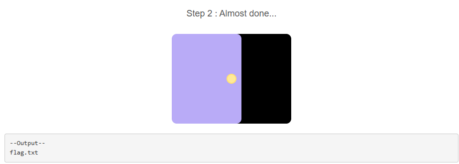

# [Web] phpreg

| 항목 | 내용 |
| --- | --- |
| 플랫폼 | Dreamhack 워게임 |
| 문제 URL | https://dreamhack.io/wargame/challenges/873 |
| 분야 | Web |
| 난이도 | B4 |
| 풀이 날짜 | 2026-10-29 |
| 소요 시간 | 10min |
| 핵심 키워드 | PHP preg_replace/preg_match, 정규식 전역 치환 우회, 블랙리스트 필터 우회, OS Command Injection |
| CWE | CWE-78 (OS Command Injection) · CWE-184 (Incomplete List of Disallowed Inputs) |

## 1. 문제 개요
2단계로 구성된 PHP 문제. 1단계(`step2.php` POST)에서 닉네임·비밀번호 입력값이 각각 정규식 치환을 거친 뒤 고정된 문자열과 정확히 일치해야 2단계로 진입할 수 있고, 2단계에서는 입력값에 "flag"라는 단어만 없으면 사용자가 입력한 명령어를 서버가 그대로 `system()`으로 실행해줍니니. 최종 목표는 2단계 명령 실행 권한을 얻어 서버의 flag 파일을 읽는 것입니다.

## 2. 정찰(Recon)
제공된 소스(`step2.php`)에서 검증 로직을 확인했습니다.

1단계:
```php
if (preg_match("/[a-zA-Z]/", $input_pw)) {
  echo "alphabet in the pw :(";
}
else{
  $name = preg_replace("/nyang/i", "", $input_name);
  $pw = preg_replace("/\d*\@\d{2,3}(31)+[^0-8\"]\!/", "d4y0r50ng", $input_pw);

  if ($name === "dnyang0310" && $pw === "d4y0r50ng+1+13") {...}
}
```

- `input_pw`에 알파벳이 하나라도 있으면 그 즉시 거부.
- 통과한 입력값은 `input_name`에서 "nyang"(대소문자 무관)이 전부 제거된 뒤 `name`으로, `input_pw`에서 정규식 `/\d*\@\d{2,3}(31)+[^0-8\"]\!/`을 만족하는 부분이 `d4y0r50ng`로 치환된 뒤 `pw`로 전달.
- `name === "dnyang0310"` 이고 `pw === "d4y0r50ng+1+13"` 이어야 2단계로 진입.

2단계:
```php
else if (preg_match("/flag/i", $cmd)) {
  echo "<pre>Error!</pre>";
}
else{
  echo "<pre>--Output--\n";
  system($cmd);
  echo "</pre>";
}
```
- 입력한 `cmd`에 "flag"라는 단어(대소문자 무관)가 없으면, 검증 없이 그대로 `system()`으로 실행.

## 3. 취약점 분석
- `preg_replace("/nyang/i", "", $input_name)`는 입력 문자열에서 "nyang" 패턴을 **찾는 대로 전부** 제거.(PHP의 `preg_replace`는 기본이 전역 치환)
- 목표값 `"dnyang0310"` 자체에 이미 "nyang"이 포함되어 있어 남아 있어야 할 "nyang"까지 같이 삭제제
  → 해결 방법: 실제로 치환되어 사라질 "nyang" 한 조각과, 치환 후에도 남아 목표 문자열을 완성할 조각("ny" + "ang")을 함께 섞어 전역 치환이 원본 문자열을 왼쪽에서 오른쪽으로 **한 번씩만** 훑는다는 점을 이용.
- pw에 알파벳은 입력 대신신`preg_replace`를 이용하여 알파벳 없이도 입력 가능.

정규식 `/\d*\@\d{2,3}(31)+[^0-8\"]\!/` 을 토큰 단위로 분해하면:

| 토큰 | 의미 |
| --- | --- |
| `\d*` | 숫자 0자 이상 |
| `\@` | 기호 "@" |
| `\d{2,3}` | 숫자 2~3자 |
| `(31)+` | 문자열 "31" 1회 이상 반복 |
| `[^0-8\"]` | `0`~`8`, `"`를 제외한 문자 1자(숫자 `9`나 기호·문자는 허용) |
| `\!` | 기호 "!" |

**`cmd` 검증 **
- `cmd`는 flag"라는 문자열 포함 여부만 검사되고, 그 외에는 검증 없이 `system($cmd)`로 넘어감감
- `system()`은 셸을 거쳐 명령을 실행하므로, 셸의 와일드카드(`*`, `?`)를 쓰면 "flag"라는 글자를 직접 입력하지 않고도 flag 파일 지정 가능
- CWE-78(OS Command Injection): 사용자 입력을 검증 없이 셸 명령으로 실행. CWE-184(Incomplete List of Disallowed Inputs): "flag"라는 단일 키워드만 막아서 와일드카드·경로 조작 등 수많은 우회 수단 존재.

## 4. 시도와 실패
| 시도 | 결과 | 배운 점 |
| --- | --- | --- |
| Step 1에서 `input1 = nyangdnyang0310` 입력 | 실패 (`name` = `"d0310"`) | php의 regex는 greedy 매칭이 기본값
| Step 2에서 `cmd = cat ../dream/flag.txt` 입력 | 실패 (`"Error!"`) | "flag"라는 리터럴 문자열이 포함되면 대소문자 구분 없이 바로 차단 |

## 5. 익스플로잇
1. Step 1 통과
   - `input1`(name): `dnynyangang0310` 입력 → `nyang` 전역 치환 후 `dnyang0310`이 됨.
   - `input2`(pw): `0@00319!+1+13` 입력 → `\d*\@\d{2,3}(31)+[^0-8"]\!` 과 정확히 일치하는 `0@00319!` 부분만 `d4y0r50ng`로 치환되어 `d4y0r50ng+1+13`이 됨.
2. Step 2 진입 후 디렉터리 구조부터 확인:
   ```bash
   ls ../dream
   ```
   
   → `flag.txt` 파일 존재를 확인.
3. "flag" 문자열을 직접 쓰지 않고 와일드카드로 파일 읽기:
   ```bash
   cat ../dream/*.txt
   ```

## 6. 방어 관점
- **근본 대책(인증 로직)**: 치환 결과 문자열을 비교하는 방식 대신 입력값 자체를 화이트리스트로 검증(허용 문자·길이 제한)하고, 정규식 치환으로 "통과 조건을 역산"할 수 있는 구조 자체를 쓰지 않는다. 비밀번호 같은 인증 요소는 해시 비교(`password_hash`/`password_verify`)로 처리합니다.
- **근본 대책(명령 실행)**: 사용자 입력을 셸 명령에 직접 연결하는 구조(`system($cmd)`) 사용을 지양합니다. 꼭 필요하다면 실행 가능한 명령/인자를 화이트리스트로 제한하고, 불가피하게 외부 입력을 셸에 넘겨야 한다면 `escapeshellarg()`로 각 인자를 이스케이프해야 합니다.
  ```php
  // 기존(취약) — 입력을 그대로 셸에 전달
  system($cmd);

  // 개선 — 애초에 임의 명령 실행 기능을 제공하지 않거나,
  // 꼭 필요하다면 허용된 명령/인자만 화이트리스트로 구성
  $allowed = ['ls', 'pwd', 'whoami'];
  if (in_array($cmd, $allowed, true)) {
      system($cmd);
  }
  ```
- **보완 대책**: "flag" 같은 단일 키워드 블랙리스트는 와일드카드(`*`, `?`), 경로 조작(`../`), 인코딩, 명령 치환(`` ` ` ``, `$()`) 등으로 손쉽게 우회되므로 가능한 허용하지 않습니다. 파일시스템 접근이 필요한 기능이라면 지정된 디렉터리 밖으로 나가지 못하도록 경로를 검증합니다.(화이트리스트 디렉터리, `realpath()` 비교)

## 7. 탐지 관점
- 웹 로그에서 `cmd` 등 명령 실행과 연결될 수 있는 파라미터 값에 셸 메타문자(`*`, `?`, `;`, `|`, `` ` ``, `$()`, `../`)가 포함된 요청을 탐지 대상으로 설정합니다.
- Sigma 스타일 초안:
  ```yaml
  title: PHP system() 호출 의심 - 셸 메타문자 포함 입력
  logsource:
    category: webserver
  detection:
    selection:
      http.method: 'POST'
      http.path: '/step2.php'
      http.body|re: "(cmd=).*(\\*|\\?|\\.\\./|\\$\\(|`)"
    condition: selection
  level: high
  ```
- 오탐 완화: 검색어처럼 `*`, `?`를 정상적으로 쓸 수 있는 필드라면 오탐이 늘어나므로, "명령 실행과 직접 연결되는 파라미터"에만 한정합니다. 동일 세션에서 `system()`류 실행 결과를 반환하는 응답 패턴(`--Output--` 같은 고정 문자열)과 함께 상관 분석하면 정확도를 높일 수 있습니다.
