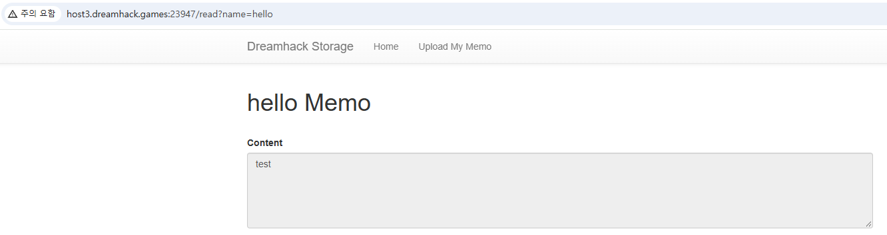

# [Web] file-download-1

| 항목 | 내용 |
| --- | --- |
| 플랫폼 | Dreamhack 워게임 |
| 문제 URL | https://dreamhack.io/wargame/challenges/37 |
| 분야 | Web |
| 난이도 | B3 |
| 풀이 날짜 | 2026-10-30 |
| 소요 시간 | 10min |
| 핵심 키워드 | Path Traversal, 비일관적 입력 검증(업로드/다운로드 필터 불일치) |
| CWE | CWE-22 (Improper Limitation of a Pathname to a Restricted Directory, 'Path Traversal') |

## 1. 문제 개요
메모를 업로드(`/upload`)하고 조회(`/read?name=...`)할 수 있는 Flask 앱. 업로드할 때는 파일명에 `..`가 들어가면 막아주지만, **조회할 때는 그런 검증이 없습니다.** 이를 이용해 `uploads/` 디렉터리 밖에 있는 `flag.py`를 읽어내는 것이 목표입니다.

## 2. 정찰(Recon)
제공된 소스(`app.py`)에서 업로드·조회 로직을 확인했습니다.

파일 업로드:
```python
@APP.route('/upload', methods=['GET', 'POST'])
def upload_memo():
    if request.method == 'POST':
        filename = request.form.get('filename')
        content = request.form.get('content').encode('utf-8')

        if filename.find('..') != -1:
            return render_template('upload_result.html', data='bad characters,,')

        with open(f'{UPLOAD_DIR}/{filename}', 'wb') as f:
            f.write(content)

        return redirect('/')
```
- 업로드할 파일명(`filename`)에 문자열 `..`가 포함되어 있으면 즉시 거부(`bad characters,,`).
- 그 외의 경로 구분자나 패턴에는 별도 제한 없음.

파일 조회:
```python
@APP.route('/read')
def read_memo():
    ...
    filename = request.args.get('name', '')

    try:
        with open(f'{UPLOAD_DIR}/{filename}', 'rb') as f:
            data = f.read()
    except (IsADirectoryError, FileNotFoundError):
        error = True
```
- `name` 파라미터로 받은 값을 **아무 검증 없이** `uploads/` 뒤에 그대로 실행.
- 업로드 쪽의 `..` 필터가 조회 쪽에는 전혀 적용되어 있지 않음.

또한 `app.py` 상단에 `from flag import FLAG`가 있어, 상위 디렉토리에 `flag.py`가 있다는 것을 추측할 수 있습니다.

## 3. 취약점 분석
- 업로드 기능은 파일명에 `..`가 있는지만 검사하는 블랙리스트 방식이고, 조회 기능은 아예 검사를 하지 않음
- `read_memo()`가 받은 `name` 값을 `f'{UPLOAD_DIR}/{filename}'` 형태로 단순 문자열 결합해 바로 `open()`에 넘기기 때문에, `name=../`처럼 상위 디렉터리로 이동하는 경로를 그대로 전달하면 `uploads/` 밖에 있는 임의 파일을 접근할 수 있음.
- CWE-22(Path Traversal) - 업로드 쪽만 막고 조회 쪽은 막지 않은 것은 CWE-184(Incomplete List of Disallowed Inputs)의 패턴도 포함

## 4. 시도와 실패
| 시도 | 결과 | 배운 점 |
| --- | --- | --- |
| `?name=flag.py` 입력 (트래버설 없이) | 실패 (`flag.py does not exist :(`) | `read_memo()`는 `uploads/` 기준 상대경로이므로, 그 디렉터리 안에 없는 파일은 경로를 더 조작해야 접근 가능 |
| `/upload`에서 `filename=../x` 업로드 시도 | 실패 (`bad characters,,`) | 업로드 쪽은 `..` 필터가 동작 — 조회로 디렉터리를 탈출해서 읽기 |

## 5. 익스플로잇
1. upload를 이용하여 임의의 데이터를 업로드합니다.



2. URL의 파라미터를 `name=hello`에서 `name=../flag.py`로 변경합니다.
3. 서버가 `uploads/../flag.py`를 열어 그 내용을 그대로 화면에 출력 — `FLAG = "..."` 전체가 노출됩니다.

## 6. 방어 관점
- **근본 대책**: 사용자가 지정한 파일명을 경로의 일부로 직접 쓰지 않는 것입니니. 업로드 시 서버가 임의의 안전한 식별자(UUID 등)를 생성해 실제 저장 경로로 쓰고, 사용자가 준 파일명은 표시용으로로로 보관합니다.
  ```python
  # 기존(취약) — 사용자 입력을 경로에 직접 결합
  with open(f'{UPLOAD_DIR}/{filename}', 'wb') as f:
      f.write(content)

  # 개선 — 경로 정규화 후 허용 디렉터리를 벗어나는지 검증
  import os
  safe_path = os.path.normpath(os.path.join(UPLOAD_DIR, filename))
  if not safe_path.startswith(os.path.abspath(UPLOAD_DIR)):
      abort(400)
  ```
- **보완 대책**: 업로드·조회 등 **같은 자원에 접근하는 모든 엔드포인트에 동일한 검증 로직을 공유**해서, 한쪽만 막고 다른 쪽은 빠뜨리는 비일관성 자체를 구조적으로 없애야 합니다. 추가로 `flag.py` 같은 민감 파일을 애플리케이션 루트(조회 가능한 디렉터리의 바로 상위)에 두지 않고, 웹 루트 바깥의 별도 경로나 환경변수로 분리합니다.

## 7. 탐지 관점
- 웹 로그에서 `name`/`file`/`filename` 류 파라미터 값에 `../`, 인코딩된 변형(`%2e%2e%2f`, `..%2f`, `....//`) 등 경로 조작 패턴이 포함된 요청을 탐지 대상으로 삼습니다.
- Sigma 스타일 초안:
  ```yaml
  title: Path Traversal 의심 - 파일 조회 파라미터에 상위 경로 이동 패턴
  logsource:
    category: webserver
  detection:
    selection:
      http.method: 'GET'
      http.path: '/read'
      http.query|re: "(\\.\\.(/|%2e%2e|%2f))"
    condition: selection
  level: high
  ```
- 오탐 완화: 정상적인 조회 파라미터에는 경로 구분자가 들어갈 일이 거의 없으므로 오탐률 자체는 낮은 편입니다.
