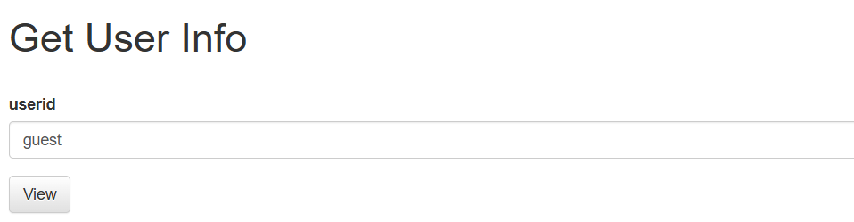
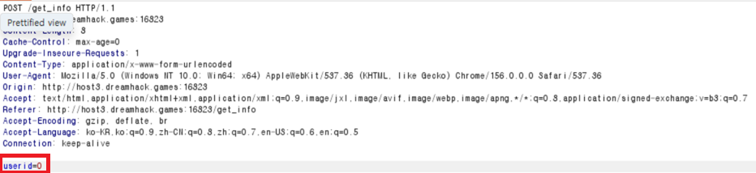
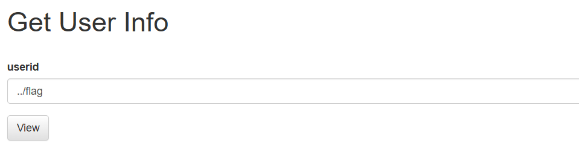
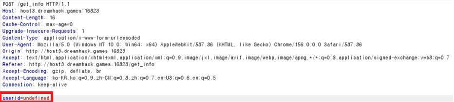
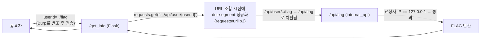
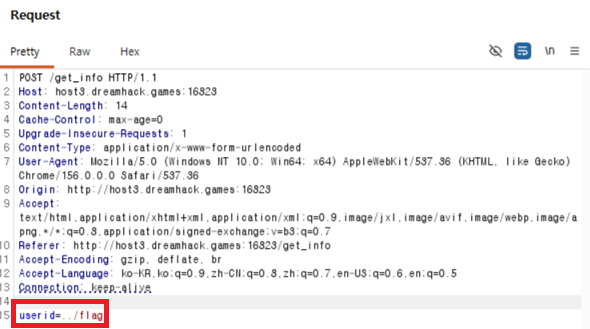
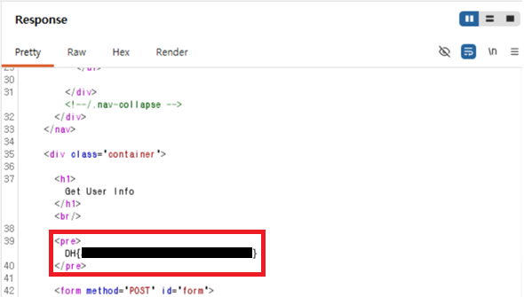

# [Web] pathtraversal

| 항목 | 내용 |
| --- | --- |
| 플랫폼 | Dreamhack 워게임 |
| 문제 URL | https://dreamhack.io/wargame/challenges/12 |
| 분야 | Web |
| 난이도 | B4 |
| 풀이 날짜 | 2026-11-3 |
| 소요 시간 | 30min |
| 핵심 키워드 | Path Traversal, SSRF 유사 패턴(Confused Deputy), 클라이언트 측 검증 우회 |
| CWE | CWE-22 (Path Traversal) · CWE-441 (Unintended Proxy or Intermediary, Confused Deputy) |

## 1. 문제 개요
"사용자 정보를 조회하는 API 서버"가 제공됩니다. `/get_info`에서 `userid`를 입력하면 서버가 내부 API(`http://127.0.0.1:8000/api/user/<uid>`)에 조회를 대신 요청해 그 결과를 보여줍니다. 플래그는 같은 내부 API의 `/api/flag`에 있고, 내부 API는 **요청자의 IP가 `127.0.0.1`일 때만** 응답합니다. 목표는 Path Traversal로 `/api/flag`에 도달해 플래그를 얻는 것입니다.

## 2. 정찰(Recon)

### 2-1. 정적 분석 — 소스 코드 리뷰
제공된 `app.py`에서 핵심 로직을 확인했습니다.

```python
def internal_api(func):
    @wraps(func)
    def decorated_view(*args, **kwargs):
        if request.remote_addr == '127.0.0.1':
            return func(*args, **kwargs)
        else:
            abort(401)
    return decorated_view

@app.route('/get_info', methods=['GET', 'POST'])
def get_info():
    ...
    userid = request.form.get('userid', '')
    info = requests.get(f'{API_HOST}/api/user/{userid}').text   # ← userid를 검증 없이 URL에 삽입
    return render_template('get_info.html', info=info)

@app.route('/api/user/<uid>')
@internal_api
def get_flag(uid):
    ...

@app.route('/api/flag')
@internal_api
def flag():
    return FLAG
```

- `internal_api`는 **요청을 보낸 쪽의 IP만** 검사합니다. "누가" 호출했는지가 아니라 "어디서" 왔는지만 봅니다.
- `/get_info`는 사용자가 보낸 `userid` 문자열을 그대로 내부 URL에 이어 붙여 `requests.get()`으로 호출합니다. 이 호출은 Flask 앱 자신이 로컬(127.0.0.1)에서 보내므로 `internal_api` 검사를 항상 통과합니다 — 앱이 공격자를 대신해 신뢰받는 요청을 대신 보내주는 구조(Confused Deputy)입니다.

### 2-2. 동적 분석 — 프록시로 실제 요청 가로채기
`/get_info` 페이지의 HTML/JS를 확인하면, 폼 제출 시 **클라이언트 측에서 입력값을 숫자로 바꿔치기**하는 코드가 있습니다.

```html
<input type="text" id="userid" name="userid" value="guest" required>
<script>
  const users = { 'guest': 0, 'admin': 1 }
  function user(evt){
    document.getElementById('userid').value = users[document.getElementById('userid').value];
    return true;
  }
  window.onload = function() {
    document.getElementById('form').addEventListener('submit', user);
  }
</script>
```

- 폼 입력란에 `guest`/`admin`을 적어도, 실제로 서버에 전송되는 값은 JS가 매핑한 `0`/`1`입니다.





- 그 외의 문자열(예: `../flag`)을 입력하면 `users['../flag']`는 `undefined`이므로, **전송되는 값이 공격자가 적은 문자열이 아니라 문자 그대로 `"undefined"`로 바뀌어 버립니다.** 즉 입력창에 직접 페이로드를 쳐서는 전송조차 되지 않습니다.





- 따라서 **요청이 브라우저를 떠나기 전, 이미 JS가 값을 바꾼 뒤 시점**에 요청을 가로채 `userid` 파라미터를 직접 조작해야 합니다 — Burp Suite 같은 프록시가 필요한 지점입니다.

### 요청 흐름 정리



## 3. 취약점 분석
- **근본 원인**: `requests.get(f'{API_HOST}/api/user/{userid}')`에서 `userid`가 검증·이스케이프 없이 URL 경로에 그대로 들어갑니다.
- 공격 조건은 요청을 한 번 가로채 파라미터만 바꾸면 되므로 난이도가 낮고, 영향은 접근 제한된 내부 API 전체 노출입니다.
- CWE-22(Path Traversal), CWE-441(Confused Deputy).

## 4. 시도와 실패
| 시도 | 결과 | 배운 점 |
| --- | --- | --- |
| 폼 입력창에 `../flag`를 직접 입력하고 제출 | 실패 (`{}` — "undefined" 조회됨) | 제출 시점에 페이지의 JS(`users['guest']=0, users['admin']=1`)가 입력값을 치환합니다. 매핑에 없는 문자열은 `undefined`로 바뀌어 전송되므로, **입력창에 직접 쓰는 방식으로는 페이로드가 전송되지 않습니다.** 프록시(Burp)로 전송 직전 요청 바디를 가로채 고쳐야 합니다 |

## 5. 익스플로잇
1. `/get_info` 페이지 소스를 확인해, 정상 흐름에서는 `userid=guest`/`admin`이 JS에 의해 `0`/`1`로 치환되어 전송됨을 확인합니다.
2. Burp Suite Proxy로 `POST /get_info` 요청을 가로채, `userid` 값을 `0`(JS가 변환한 값)에서 `../flag`로 직접 바꿉니다. (Repeater로 보내 반복 테스트하면 편합니다.)



3. 내부 API는 요청 출발지가 `127.0.0.1`이므로 통과시키고, `/api/flag` 라우트가 플래그를 그대로 응답합니다. 이 응답이 `/get_info` 페이지의 `<pre>` 태그에 그대로 렌더링됩니다.



## 6. 방어 관점
- **근본 대책(경로 검증)**: 사용자 입력을 내부 요청 URL의 경로에 직접 결합하지 않습니다. 허용된 값만 화이트리스트로 검증하거나, `uid`를 라우트 파라미터가 아니라 쿼리 파라미터로 전달해 경로 조합 자체를 없앱니다.
  ```python
  # 기존(취약) — 입력을 URL 경로에 직접 결합
  info = requests.get(f'{API_HOST}/api/user/{userid}').text

  # 개선 1 — 허용된 값만 화이트리스트로 검증
  if userid not in users:          # 또는 정수 캐스팅 후 범위 검사
      abort(400)
  info = requests.get(f'{API_HOST}/api/user/{userid}').text

  # 개선 2 — 쿼리 파라미터로 전달해 경로 조합을 피함
  info = requests.get(f'{API_HOST}/api/user', params={'uid': userid}).text
  ```
- **보완 대책**:
  - 민감한 내부 엔드포인트(`/api/flag`)는 애초에 공개 라우트에서 도달 가능한 프록시 경로를 두지 않고, 별도 네트워크/포트로 분리합니다.

## 7. 탐지 관점
- 웹 로그에서 서버가 **자기 자신(127.0.0.1)으로 보내는 아웃바운드 요청**의 URL에 `../`, 인코딩된 변형(`%2e%2e`)이 포함되는 패턴을 탐지 대상으로 삼습니다. (애플리케이션 레벨 로깅 또는 egress 프록시 로그 필요)
- Sigma 스타일 초안:
  ```yaml
  title: 내부 API 호출 URL에 경로 조작 패턴 포함 (Path Traversal → Confused Deputy)
  logsource:
    category: application
  detection:
    selection:
      event: 'outbound_http_request'
      dest_ip: '127.0.0.1'
      url|re: "(\\.\\.(/|%2e%2e))"
    condition: selection
  level: high
  ```
- 웹 접근 로그 측면에서도 `/get_info`의 `userid` 파라미터 값에 `../`, `%2e%2e`가 포함된 요청을 1차 탐지 규칙으로 둡니다.
- 오탐 완화: 애플리케이션이 정상적으로 상대경로를 다루는 기능이 있다면(파일 업로드/다운로드 등) 함께 상관분석이 필요합니다. 여기서는 `userid` 파라미터가 숫자 ID 하나만 기대하는 필드이므로, 영문자·구분자가 섞인 값 자체가 비정상 신호로 보기 쉽습니다.
